# Schema guide: Clinic system (Oracle ALL_TAB_COLUMNS export)

> Generated by [Any Schema](https://github.com/adityakilari/any-schema) v1.0.0 on 2026-10-18 from JSON column list (Oracle). Explanations are inferred from names, types and constraints, so review them before relying on them.

## Overview

This JSON column list (Oracle) describes 38 tables with 350 columns in total. It looks like a healthcare data model (based on `patient`, `appointment`, `prescription`, `diagnosis` and `encounter`), with some billing / finance elements. The central tables are `SM` (referenced by 9 tables), `PRV` (referenced by 7 tables) and `ENC` (referenced by 7 tables). There are 51 relationships: 0 declared and 51 inferred from column names. The review found 1 high, 0 medium and 0 low priority issues, plus 2 suggestions. 26 columns look like personal or sensitive data, 9 of them highly sensitive.

| Tables | Views | Columns | Relationships | Inferred | Findings | Sensitive columns |
|---|---|---|---|---|---|---|
| 38 | 0 | 350 | 51 | 51 | 3 | 26 |

- _Note:_ clinic-oracle-columns.json has no primary/foreign key columns, so keys were inferred from column names. Use the database-specific export query for exact keys.

## Diagram

```mermaid
erDiagram
  ORG {
    NUMBER_10_0 ORG_ID PK
  }
  ORG_ADDR {
    NUMBER_10_0 ORG_ADDR_ID PK
    NUMBER_10_0 ORG_ID FK
  }
  ORG_TYPE {
    VARCHAR2_10 ORG_TYPE_CD
    VARCHAR2_100 ORG_TYPE_DESC
  }
  SM {
    NUMBER_10_0 SM_ID PK
    NUMBER_10_0 DEPT_ID FK
  }
  SM_ROLE {
    NUMBER_10_0 SM_ROLE_ID PK
    NUMBER_10_0 SM_ID FK
  }
  DEPT {
    NUMBER_10_0 DEPT_ID PK
    NUMBER_10_0 ORG_ID FK
    NUMBER_10_0 MGR_SM_ID FK
  }
  PAT {
    NUMBER_10_0 PAT_ID PK
    NUMBER_10_0 PRIMARY_PRV_ID FK
  }
  PAT_ADDR {
    NUMBER_10_0 PAT_ADDR_ID PK
    NUMBER_10_0 PAT_ID FK
  }
  PAT_INS {
    NUMBER_10_0 PAT_INS_ID PK
    NUMBER_10_0 PAT_ID FK
    NUMBER_10_0 PAYER_ID FK
  }
  PAYER {
    NUMBER_10_0 PAYER_ID PK
    NUMBER_10_0 ORG_ID FK
  }
  PRV {
    NUMBER_10_0 PRV_ID PK
    NUMBER_10_0 DEPT_ID FK
    NUMBER_10_0 SM_ID FK
  }
  PRV_LIC {
    NUMBER_10_0 PRV_LIC_ID PK
    NUMBER_10_0 PRV_ID FK
  }
  ENC {
    NUMBER_10_0 ENC_ID PK
    NUMBER_10_0 PAT_ID FK
    NUMBER_10_0 ATTND_PRV_ID FK
    NUMBER_10_0 DEPT_ID FK
  }
  ENC_DX {
    NUMBER_10_0 ENC_DX_ID PK
    NUMBER_10_0 ENC_ID FK
  }
  ENC_NOTE {
    NUMBER_10_0 ENC_NOTE_ID PK
    NUMBER_10_0 ENC_ID FK
    NUMBER_10_0 AUTHOR_SM_ID FK
  }
  ENC_TYPE {
    VARCHAR2_10 ENC_TYPE_CD
    VARCHAR2_100 ENC_TYPE_DESC
  }
  DX {
    VARCHAR2_10 DX_CD
    VARCHAR2_400 DX_DESC
    VARCHAR2_5 ICD_VER
  }
  ORD {
    NUMBER_10_0 ORD_ID PK
    NUMBER_10_0 ENC_ID FK
    NUMBER_10_0 ORD_PRV_ID FK
  }
  ORD_ITEM {
    NUMBER_10_0 ORD_ITEM_ID PK
    NUMBER_10_0 ORD_ID FK
  }
  LAB_RSLT {
    NUMBER_10_0 LAB_RSLT_ID PK
    NUMBER_10_0 ORD_ITEM_ID FK
    NUMBER_10_0 VRFY_SM_ID FK
  }
  RX {
    NUMBER_10_0 RX_ID PK
    NUMBER_10_0 ENC_ID FK
    NUMBER_10_0 PAT_ID FK
    NUMBER_10_0 PRSCRB_PRV_ID FK
  }
  DRUG {
    VARCHAR2_20 DRUG_CD
    VARCHAR2_200 DRUG_NM
    VARCHAR2_1 CTRL_SUBST_IND
  }
  SCH_APPT {
    NUMBER_10_0 SCH_APPT_ID PK
    NUMBER_10_0 PAT_ID FK
    NUMBER_10_0 PRV_ID FK
    NUMBER_10_0 DEPT_ID FK
    NUMBER_10_0 ENC_ID FK
  }
  SCH_SLOT {
    NUMBER_10_0 SCH_SLOT_ID PK
    NUMBER_10_0 PRV_ID FK
  }
  BILL_CHG {
    NUMBER_10_0 BILL_CHG_ID PK
    NUMBER_10_0 ENC_ID FK
    NUMBER_10_0 ORD_ITEM_ID FK
  }
  BILL_CLM {
    NUMBER_10_0 BILL_CLM_ID PK
    NUMBER_10_0 ENC_ID FK
    NUMBER_10_0 PAT_INS_ID FK
  }
  BILL_CLM_LN {
    NUMBER_10_0 BILL_CLM_LN_ID PK
    NUMBER_10_0 BILL_CLM_ID FK
    NUMBER_10_0 BILL_CHG_ID FK
  }
  BILL_PMT {
    NUMBER_10_0 BILL_PMT_ID PK
    NUMBER_10_0 BILL_CLM_ID FK
    NUMBER_10_0 PAT_ID FK
  }
  BILL_ADJ {
    NUMBER_10_0 BILL_ADJ_ID PK
    NUMBER_10_0 BILL_CLM_ID FK
    NUMBER_10_0 RSPBL_SM_ID FK
  }
  INV_ITEM {
    NUMBER_10_0 INV_ITEM_ID PK
  }
  INV_STOCK {
    NUMBER_10_0 INV_STOCK_ID PK
    NUMBER_10_0 INV_ITEM_ID FK
    NUMBER_10_0 DEPT_ID FK
  }
  INV_PO {
    NUMBER_10_0 INV_PO_ID PK
    NUMBER_10_0 VENDOR_ORG_ID FK
    NUMBER_10_0 APPRV_SM_ID FK
  }
  INV_PO_LN {
    NUMBER_10_0 INV_PO_LN_ID PK
    NUMBER_10_0 INV_PO_ID FK
    NUMBER_10_0 INV_ITEM_ID FK
  }
  DOC_ATTCH {
    NUMBER_10_0 DOC_ATTCH_ID PK
    NUMBER_10_0 UPLD_SM_ID FK
  }
  AUDIT_EVT {
    NUMBER_10_0 AUDIT_EVT_ID PK
    NUMBER_10_0 SM_ID FK
  }
  IMP_BATCH {
    NUMBER_10_0 IMP_BATCH_ID PK
  }
  IMP_ERR {
    NUMBER_10_0 IMP_ERR_ID PK
    NUMBER_10_0 IMP_BATCH_ID FK
  }
  TMP_PAT_LOAD {
    VARCHAR2_20 MRN
    VARCHAR2_50 FIRST_NM
    VARCHAR2_50 LAST_NM
  }
  ORG ||..o{ ORG_ADDR : "ORG_ID (inferred)"
  DEPT |o..o{ SM : "DEPT_ID (inferred)"
  SM ||..o{ SM_ROLE : "SM_ID (inferred)"
  ORG ||..o{ DEPT : "ORG_ID (inferred)"
  SM |o..o{ DEPT : "MGR_SM_ID (inferred)"
  PRV |o..o{ PAT : "PRIMARY_PRV_ID (inferred)"
  PAT ||..o{ PAT_ADDR : "PAT_ID (inferred)"
  PAT ||..o{ PAT_INS : "PAT_ID (inferred)"
  PAYER ||..o{ PAT_INS : "PAYER_ID (inferred)"
  ORG |o..o{ PAYER : "ORG_ID (inferred)"
  DEPT |o..o{ PRV : "DEPT_ID (inferred)"
  SM |o..o{ PRV : "SM_ID (inferred)"
  PRV ||..o{ PRV_LIC : "PRV_ID (inferred)"
  PAT ||..o{ ENC : "PAT_ID (inferred)"
  PRV |o..o{ ENC : "ATTND_PRV_ID (inferred)"
  DEPT ||..o{ ENC : "DEPT_ID (inferred)"
  ENC ||..o{ ENC_DX : "ENC_ID (inferred)"
  ENC ||..o{ ENC_NOTE : "ENC_ID (inferred)"
  SM ||..o{ ENC_NOTE : "AUTHOR_SM_ID (inferred)"
  ENC ||..o{ ORD : "ENC_ID (inferred)"
  PRV ||..o{ ORD : "ORD_PRV_ID (inferred)"
  ORD ||..o{ ORD_ITEM : "ORD_ID (inferred)"
  ORD_ITEM ||..o{ LAB_RSLT : "ORD_ITEM_ID (inferred)"
  SM |o..o{ LAB_RSLT : "VRFY_SM_ID (inferred)"
  ENC |o..o{ RX : "ENC_ID (inferred)"
  PAT ||..o{ RX : "PAT_ID (inferred)"
  PRV ||..o{ RX : "PRSCRB_PRV_ID (inferred)"
  PAT ||..o{ SCH_APPT : "PAT_ID (inferred)"
  PRV ||..o{ SCH_APPT : "PRV_ID (inferred)"
  DEPT ||..o{ SCH_APPT : "DEPT_ID (inferred)"
  ENC |o..o{ SCH_APPT : "ENC_ID (inferred)"
  PRV ||..o{ SCH_SLOT : "PRV_ID (inferred)"
  ENC ||..o{ BILL_CHG : "ENC_ID (inferred)"
  ORD_ITEM |o..o{ BILL_CHG : "ORD_ITEM_ID (inferred)"
  ENC ||..o{ BILL_CLM : "ENC_ID (inferred)"
  PAT_INS ||..o{ BILL_CLM : "PAT_INS_ID (inferred)"
  BILL_CLM ||..o{ BILL_CLM_LN : "BILL_CLM_ID (inferred)"
  BILL_CHG ||..o{ BILL_CLM_LN : "BILL_CHG_ID (inferred)"
  BILL_CLM |o..o{ BILL_PMT : "BILL_CLM_ID (inferred)"
  PAT |o..o{ BILL_PMT : "PAT_ID (inferred)"
  BILL_CLM ||..o{ BILL_ADJ : "BILL_CLM_ID (inferred)"
  SM ||..o{ BILL_ADJ : "RSPBL_SM_ID (inferred)"
  INV_ITEM ||..o{ INV_STOCK : "INV_ITEM_ID (inferred)"
  DEPT ||..o{ INV_STOCK : "DEPT_ID (inferred)"
  ORG ||..o{ INV_PO : "VENDOR_ORG_ID (inferred)"
  SM |o..o{ INV_PO : "APPRV_SM_ID (inferred)"
  INV_PO ||..o{ INV_PO_LN : "INV_PO_ID (inferred)"
  INV_ITEM ||..o{ INV_PO_LN : "INV_ITEM_ID (inferred)"
  SM ||..o{ DOC_ATTCH : "UPLD_SM_ID (inferred)"
  SM |o..o{ AUDIT_EVT : "SM_ID (inferred)"
  IMP_BATCH ||..o{ IMP_ERR : "IMP_BATCH_ID (inferred)"
```



## Tables

| Table | Role | Purpose |
|---|---|---|
| [ORG](#org) | Core entity | Stores organizations: one row per organization, identified by `ORG_ID`. |
| [ORG_ADDR](#org_addr) | Entity | Stores organization addresses: one row per organization address, identified by `ORG_ADDR_ID`. |
| [ORG_TYPE](#org_type) | Lookup | Reference list of organization types: a small, mostly static set of values that other tables point to instead of repeating the text. |
| [SM](#sm) | Core entity | Stores staff members: one row per staff member, identified by `SM_ID`. |
| [SM_ROLE](#sm_role) | Entity | Stores staff member roles: one row per staff member role, identified by `SM_ROLE_ID`. |
| [DEPT](#dept) | Core entity | Stores departments: one row per department, identified by `DEPT_ID`. |
| [PAT](#pat) | Core entity | Stores patients: one row per patient, identified by `PAT_ID`. |
| [PAT_ADDR](#pat_addr) | Entity | Stores patient addresses: one row per patient address, identified by `PAT_ADDR_ID`. |
| [PAT_INS](#pat_ins) | Entity | Stores patient insurances: one row per patient insurance, identified by `PAT_INS_ID`. |
| [PAYER](#payer) | Entity | Stores payers: one row per payer, identified by `PAYER_ID`. |
| [PRV](#prv) | Core entity | Stores providers: one row per provider, identified by `PRV_ID`. |
| [PRV_LIC](#prv_lic) | Entity | Stores provider licenses: one row per provider license, identified by `PRV_LIC_ID`. |
| [ENC](#enc) | Core entity | Stores encounters: one row per encounter, identified by `ENC_ID`. |
| [ENC_DX](#enc_dx) | Entity | Stores encounter diagnosises: one row per encounter diagnosis, identified by `ENC_DX_ID`. |
| [ENC_NOTE](#enc_note) | Entity | Stores encounter notes: one row per encounter note, identified by `ENC_NOTE_ID`. |
| [ENC_TYPE](#enc_type) | Lookup | Reference list of encounter types: a small, mostly static set of values that other tables point to instead of repeating the text. |
| [DX](#dx) | Entity | Stores diagnosises: one row per diagnosis. |
| [ORD](#ord) | Transaction | Records orders: each row is one order, identified by `ORD_ID`. |
| [ORD_ITEM](#ord_item) | Line items | The individual lines of an order: one row per order item. |
| [LAB_RSLT](#lab_rslt) | Entity | Stores lab results: one row per lab result, identified by `LAB_RSLT_ID`. |
| [RX](#rx) | Entity | Stores prescriptions: one row per prescription, identified by `RX_ID`. |
| [DRUG](#drug) | Entity | Stores drugs: one row per drug. |
| [SCH_APPT](#sch_appt) | Transaction | Records schedule appointments: each row is one schedule appointment, identified by `SCH_APPT_ID`. |
| [SCH_SLOT](#sch_slot) | Entity | Stores schedule slots: one row per schedule slot, identified by `SCH_SLOT_ID`. |
| [BILL_CHG](#bill_chg) | Transaction | Records bill charges: each row is one bill charge, identified by `BILL_CHG_ID`. |
| [BILL_CLM](#bill_clm) | Transaction | Records bill claims: each row is one bill claim, identified by `BILL_CLM_ID`. |
| [BILL_CLM_LN](#bill_clm_ln) | Line items | The individual lines of a bill claim: one row per bill claim line. |
| [BILL_PMT](#bill_pmt) | Transaction | Records bill payments: each row is one bill payment, identified by `BILL_PMT_ID`. |
| [BILL_ADJ](#bill_adj) | Entity | Stores bill adjustments: one row per bill adjustment, identified by `BILL_ADJ_ID`. |
| [INV_ITEM](#inv_item) | Transaction | Records invoice items: each row is one invoice item, identified by `INV_ITEM_ID`. |
| [INV_STOCK](#inv_stock) | Transaction | Records invoice stocks: each row is one invoice stock, identified by `INV_STOCK_ID`. |
| [INV_PO](#inv_po) | Transaction | Records invoice purchase orders: each row is one invoice purchase order, identified by `INV_PO_ID`. |
| [INV_PO_LN](#inv_po_ln) | Line items | The individual lines of an invoice purchase order: one row per invoice purchase order line. |
| [DOC_ATTCH](#doc_attch) | Entity | Stores document attachments: one row per document attachment, identified by `DOC_ATTCH_ID`. |
| [AUDIT_EVT](#audit_evt) | Log / history | History table: each row records something that happened to a staff member. |
| [IMP_BATCH](#imp_batch) | Entity | Stores import batches: one row per import batch, identified by `IMP_BATCH_ID`. |
| [IMP_ERR](#imp_err) | Entity | Stores import errors: one row per import error, identified by `IMP_ERR_ID`. |
| [TMP_PAT_LOAD](#tmp_pat_load) | Entity | Stores tmp patient loads: one row per tmp patient load. |

### ORG

**Core entity** · schema `CLINIC`

Stores organizations: one row per organization, identified by `ORG_ID`. Referenced by 4 tables: `ORG_ADDR`, `DEPT`, `PAYER` and `INV_PO`.

| Column | Type | Null | Keys | Description |
|---|---|---|---|---|
| `ORG_ID` | NUMBER(10,0) | no | PK | Primary key: uniquely identifies each organization. Assumed primary key (unique, never empty), not declared in the source. |
| `ORG_NM` | VARCHAR2(200) | no |  | Name of the organization, as shown to people. Required. |
| `ORG_TYPE_CD` | VARCHAR2(10) | no |  | Organization type code. Required. |
| `TAX_ID_NBR` | VARCHAR2(20) | yes | PII | Tax id number (optional). |
| `ACTV_IND` | VARCHAR2(1) | no |  | Text (up to 1 characters): the organization's actv indicator. Required. |
| `ROW_INS_TMSP` | TIMESTAMP(6) | no |  | When this organization record was inserted. Required. |
| `ROW_INS_UID` | VARCHAR2(30) | no |  | User or process that created this organization record. Required. |
| `ROW_TMSP` | TIMESTAMP(6) | no |  | When this organization record was last written. Required. |
| `ROW_UID` | VARCHAR2(30) | no |  | User or process that last changed this organization record. Required. |

### ORG_ADDR

**Entity** · schema `CLINIC`

Stores organization addresses: one row per organization address, identified by `ORG_ADDR_ID`. Each organization address belongs to an organization.

| Column | Type | Null | Keys | Description |
|---|---|---|---|---|
| `ORG_ADDR_ID` | NUMBER(10,0) | no | PK | Primary key: uniquely identifies each organization address. Assumed primary key (unique, never empty), not declared in the source. |
| `ORG_ID` | NUMBER(10,0) | no | FK? | Probably references `ORG.ORG_ID`. Links each organization address to the organization it belongs to; one organization can have many organization addresses. Inferred from the column name: no foreign-key constraint is declared. Required: every organization address must have an organization. |
| `ADDR_TYPE_CD` | VARCHAR2(10) | no |  | Address type code. Required. |
| `STREET_ADDR` | VARCHAR2(200) | yes | PII | Street address. |
| `CITY_NM` | VARCHAR2(80) | yes |  | Text (up to 80 characters): the organization address's city name. |
| `ST_CD` | VARCHAR2(2) | yes |  | St code (optional). |
| `ZIP_CD` | VARCHAR2(10) | yes | PII | Postal / ZIP code. |
| `ROW_INS_TMSP` | TIMESTAMP(6) | no |  | When this organization address record was inserted. Required. |
| `ROW_INS_UID` | VARCHAR2(30) | no |  | User or process that created this organization address record. Required. |
| `ROW_TMSP` | TIMESTAMP(6) | no |  | When this organization address record was last written. Required. |
| `ROW_UID` | VARCHAR2(30) | no |  | User or process that last changed this organization address record. Required. |

### ORG_TYPE

**Lookup** · schema `CLINIC`

Reference list of organization types: a small, mostly static set of values that other tables point to instead of repeating the text.

| Column | Type | Null | Keys | Description |
|---|---|---|---|---|
| `ORG_TYPE_CD` | VARCHAR2(10) | no |  | Business code people use to refer to the organization type. Required. |
| `ORG_TYPE_DESC` | VARCHAR2(100) | no |  | Text (up to 100 characters): the organization type's organization type description. Required. |

### SM

**Core entity** · schema `CLINIC`

Stores staff members: one row per staff member, identified by `SM_ID`. It can optionally be linked to a department. Referenced by 9 tables: `SM_ROLE`, `DEPT`, `PRV`, `ENC_NOTE`, `LAB_RSLT`, `BILL_ADJ` and 3 more.

| Column | Type | Null | Keys | Description |
|---|---|---|---|---|
| `SM_ID` | NUMBER(10,0) | no | PK | Primary key: uniquely identifies each staff member. Assumed primary key (unique, never empty), not declared in the source. |
| `LOGIN_NM` | VARCHAR2(50) | no |  | Text (up to 50 characters): the staff member's login name. Required. |
| `FIRST_NM` | VARCHAR2(50) | no | PII | First (given) name. Required. |
| `LAST_NM` | VARCHAR2(50) | no | PII | Last (family) name. Required. |
| `EML_ADDR` | VARCHAR2(200) | yes | PII | Email address. |
| `DEPT_ID` | NUMBER(10,0) | yes | FK? | Probably references `DEPT.DEPT_ID`. Links each staff member to the department it belongs to; one department can have many staff members. Inferred from the column name: no foreign-key constraint is declared. Optional: a staff member can exist without a department. |
| `ACTV_IND` | VARCHAR2(1) | no |  | Text (up to 1 characters): the staff member's actv indicator. Required. |
| `ROW_INS_TMSP` | TIMESTAMP(6) | no |  | When this staff member record was inserted. Required. |
| `ROW_INS_UID` | VARCHAR2(30) | no |  | User or process that created this staff member record. Required. |
| `ROW_TMSP` | TIMESTAMP(6) | no |  | When this staff member record was last written. Required. |
| `ROW_UID` | VARCHAR2(30) | no |  | User or process that last changed this staff member record. Required. |

### SM_ROLE

**Entity** · schema `CLINIC`

Stores staff member roles: one row per staff member role, identified by `SM_ROLE_ID`. Each staff member role belongs to a staff member.

| Column | Type | Null | Keys | Description |
|---|---|---|---|---|
| `SM_ROLE_ID` | NUMBER(10,0) | no | PK | Primary key: uniquely identifies each staff member role. Assumed primary key (unique, never empty), not declared in the source. |
| `SM_ID` | NUMBER(10,0) | no | FK? | Probably references `SM.SM_ID`. Links each staff member role to the staff member it belongs to; one staff member can have many staff member roles. Inferred from the column name: no foreign-key constraint is declared. Required: every staff member role must have a staff member. |
| `ROLE_CD` | VARCHAR2(20) | no |  | Role code. Required. |
| `EFF_DT` | DATE | no |  | Effective date of the staff member role. Required. |
| `EXPR_DT` | DATE | yes |  | Expiration date of the staff member role. |
| `ROW_INS_TMSP` | TIMESTAMP(6) | no |  | When this staff member role record was inserted. Required. |
| `ROW_INS_UID` | VARCHAR2(30) | no |  | User or process that created this staff member role record. Required. |
| `ROW_TMSP` | TIMESTAMP(6) | no |  | When this staff member role record was last written. Required. |
| `ROW_UID` | VARCHAR2(30) | no |  | User or process that last changed this staff member role record. Required. |

### DEPT

**Core entity** · schema `CLINIC`

Stores departments: one row per department, identified by `DEPT_ID`. Each department belongs to an organization. It can optionally be linked to a staff member. Referenced by 5 tables: `SM`, `PRV`, `ENC`, `SCH_APPT` and `INV_STOCK`.

| Column | Type | Null | Keys | Description |
|---|---|---|---|---|
| `DEPT_ID` | NUMBER(10,0) | no | PK | Primary key: uniquely identifies each department. Assumed primary key (unique, never empty), not declared in the source. |
| `DEPT_NM` | VARCHAR2(100) | no |  | Name of the department, as shown to people. Required. |
| `ORG_ID` | NUMBER(10,0) | no | FK? | Probably references `ORG.ORG_ID`. Links each department to the organization it belongs to; one organization can have many departments. Inferred from the column name: no foreign-key constraint is declared. Required: every department must have an organization. |
| `MGR_SM_ID` | NUMBER(10,0) | yes | FK? | Probably references `SM.SM_ID`. The staff member who is this department's manager. Inferred from the column name: no foreign-key constraint is declared. Optional: a department can exist without a staff member. |
| `ROW_INS_TMSP` | TIMESTAMP(6) | no |  | When this department record was inserted. Required. |
| `ROW_INS_UID` | VARCHAR2(30) | no |  | User or process that created this department record. Required. |
| `ROW_TMSP` | TIMESTAMP(6) | no |  | When this department record was last written. Required. |
| `ROW_UID` | VARCHAR2(30) | no |  | User or process that last changed this department record. Required. |

### PAT

**Core entity** · schema `CLINIC`

Stores patients: one row per patient, identified by `PAT_ID`. It can optionally be linked to a provider. Referenced by 6 tables: `PAT_ADDR`, `PAT_INS`, `ENC`, `RX`, `SCH_APPT` and `BILL_PMT`.

| Column | Type | Null | Keys | Description |
|---|---|---|---|---|
| `PAT_ID` | NUMBER(10,0) | no | PK | Primary key: uniquely identifies each patient. Assumed primary key (unique, never empty), not declared in the source. |
| `MRN` | VARCHAR2(20) | no | PII | Medical record number. Required. |
| `FIRST_NM` | VARCHAR2(50) | no | PII | First (given) name. Required. |
| `LAST_NM` | VARCHAR2(50) | no | PII | Last (family) name. Required. |
| `BIRTH_DT` | DATE | no | PII | Date of birth. Required. |
| `GENDER_CD` | VARCHAR2(1) | yes |  | Gender code (optional). |
| `SSN` | VARCHAR2(11) | yes | PII | Text (up to 11 characters): the patient's ssn. |
| `PHN_NBR` | VARCHAR2(20) | yes | PII | Phone number. |
| `EML_ADDR` | VARCHAR2(200) | yes | PII | Email address. |
| `PRIMARY_PRV_ID` | NUMBER(10,0) | yes | FK? | Probably references `PRV.PRV_ID`. The provider who is this patient's primary provider. Inferred from the column name: no foreign-key constraint is declared. Optional: a patient can exist without a provider. |
| `ROW_INS_TMSP` | TIMESTAMP(6) | no |  | When this patient record was inserted. Required. |
| `ROW_INS_UID` | VARCHAR2(30) | no |  | User or process that created this patient record. Required. |
| `ROW_TMSP` | TIMESTAMP(6) | no |  | When this patient record was last written. Required. |
| `ROW_UID` | VARCHAR2(30) | no |  | User or process that last changed this patient record. Required. |

### PAT_ADDR

**Entity** · schema `CLINIC`

Stores patient addresses: one row per patient address, identified by `PAT_ADDR_ID`. Each patient address belongs to a patient.

| Column | Type | Null | Keys | Description |
|---|---|---|---|---|
| `PAT_ADDR_ID` | NUMBER(10,0) | no | PK | Primary key: uniquely identifies each patient address. Assumed primary key (unique, never empty), not declared in the source. |
| `PAT_ID` | NUMBER(10,0) | no | FK? | Probably references `PAT.PAT_ID`. Links each patient address to the patient it belongs to; one patient can have many patient addresses. Inferred from the column name: no foreign-key constraint is declared. Required: every patient address must have a patient. |
| `STREET_ADDR` | VARCHAR2(200) | no | PII | Street address. Required. |
| `CITY_NM` | VARCHAR2(80) | no |  | Text (up to 80 characters): the patient address's city name. Required. |
| `ZIP_CD` | VARCHAR2(10) | yes | PII | Postal / ZIP code. |
| `EFF_DT` | DATE | no |  | Effective date of the patient address. Required. |
| `ROW_INS_TMSP` | TIMESTAMP(6) | no |  | When this patient address record was inserted. Required. |
| `ROW_INS_UID` | VARCHAR2(30) | no |  | User or process that created this patient address record. Required. |
| `ROW_TMSP` | TIMESTAMP(6) | no |  | When this patient address record was last written. Required. |
| `ROW_UID` | VARCHAR2(30) | no |  | User or process that last changed this patient address record. Required. |

### PAT_INS

**Entity** · schema `CLINIC`

Stores patient insurances: one row per patient insurance, identified by `PAT_INS_ID`. Each patient insurance belongs to a patient and a payer. Referenced by `BILL_CLM`.

| Column | Type | Null | Keys | Description |
|---|---|---|---|---|
| `PAT_INS_ID` | NUMBER(10,0) | no | PK | Primary key: uniquely identifies each patient insurance. Assumed primary key (unique, never empty), not declared in the source. |
| `PAT_ID` | NUMBER(10,0) | no | FK? | Probably references `PAT.PAT_ID`. Links each patient insurance to the patient it belongs to; one patient can have many patient insurances. Inferred from the column name: no foreign-key constraint is declared. Required: every patient insurance must have a patient. |
| `PAYER_ID` | NUMBER(10,0) | no | FK? | Probably references `PAYER.PAYER_ID`. Links each patient insurance to the payer it belongs to; one payer can have many patient insurances. Inferred from the column name: no foreign-key constraint is declared. Required: every patient insurance must have a payer. |
| `POL_NBR` | VARCHAR2(40) | no |  | Policy number. Required. |
| `GRP_NBR` | VARCHAR2(40) | yes |  | Group number (optional). |
| `EFF_DT` | DATE | no |  | Effective date of the patient insurance. Required. |
| `EXPR_DT` | DATE | yes |  | Expiration date of the patient insurance. |
| `ROW_INS_TMSP` | TIMESTAMP(6) | no |  | When this patient insurance record was inserted. Required. |
| `ROW_INS_UID` | VARCHAR2(30) | no |  | User or process that created this patient insurance record. Required. |
| `ROW_TMSP` | TIMESTAMP(6) | no |  | When this patient insurance record was last written. Required. |
| `ROW_UID` | VARCHAR2(30) | no |  | User or process that last changed this patient insurance record. Required. |

### PAYER

**Entity** · schema `CLINIC`

Stores payers: one row per payer, identified by `PAYER_ID`. It can optionally be linked to an organization. Referenced by `PAT_INS`.

| Column | Type | Null | Keys | Description |
|---|---|---|---|---|
| `PAYER_ID` | NUMBER(10,0) | no | PK | Primary key: uniquely identifies each payer. Assumed primary key (unique, never empty), not declared in the source. |
| `PAYER_NM` | VARCHAR2(200) | no |  | Name of the payer, as shown to people. Required. |
| `PAYER_TYPE_CD` | VARCHAR2(10) | no |  | Payer type code. Required. |
| `ORG_ID` | NUMBER(10,0) | yes | FK? | Probably references `ORG.ORG_ID`. Links each payer to the organization it belongs to; one organization can have many payers. Inferred from the column name: no foreign-key constraint is declared. Optional: a payer can exist without an organization. |
| `ROW_INS_TMSP` | TIMESTAMP(6) | no |  | When this payer record was inserted. Required. |
| `ROW_INS_UID` | VARCHAR2(30) | no |  | User or process that created this payer record. Required. |
| `ROW_TMSP` | TIMESTAMP(6) | no |  | When this payer record was last written. Required. |
| `ROW_UID` | VARCHAR2(30) | no |  | User or process that last changed this payer record. Required. |

### PRV

**Core entity** · schema `CLINIC`

Stores providers: one row per provider, identified by `PRV_ID`. It can optionally be linked to a department and a staff member. Referenced by 7 tables: `PAT`, `PRV_LIC`, `ENC`, `ORD`, `RX`, `SCH_APPT` and 1 more.

| Column | Type | Null | Keys | Description |
|---|---|---|---|---|
| `PRV_ID` | NUMBER(10,0) | no | PK | Primary key: uniquely identifies each provider. Assumed primary key (unique, never empty), not declared in the source. |
| `NPI_NBR` | VARCHAR2(10) | no |  | Npi number. Required. |
| `FIRST_NM` | VARCHAR2(50) | no | PII | First (given) name. Required. |
| `LAST_NM` | VARCHAR2(50) | no | PII | Last (family) name. Required. |
| `SPCLTY_CD` | VARCHAR2(10) | yes |  | Specialty code (optional). |
| `DEPT_ID` | NUMBER(10,0) | yes | FK? | Probably references `DEPT.DEPT_ID`. Links each provider to the department it belongs to; one department can have many providers. Inferred from the column name: no foreign-key constraint is declared. Optional: a provider can exist without a department. |
| `SM_ID` | NUMBER(10,0) | yes | FK? | Probably references `SM.SM_ID`. Links each provider to the staff member it belongs to; one staff member can have many providers. Inferred from the column name: no foreign-key constraint is declared. Optional: a provider can exist without a staff member. |
| `ROW_INS_TMSP` | TIMESTAMP(6) | no |  | When this provider record was inserted. Required. |
| `ROW_INS_UID` | VARCHAR2(30) | no |  | User or process that created this provider record. Required. |
| `ROW_TMSP` | TIMESTAMP(6) | no |  | When this provider record was last written. Required. |
| `ROW_UID` | VARCHAR2(30) | no |  | User or process that last changed this provider record. Required. |

### PRV_LIC

**Entity** · schema `CLINIC`

Stores provider licenses: one row per provider license, identified by `PRV_LIC_ID`. Each provider license belongs to a provider.

| Column | Type | Null | Keys | Description |
|---|---|---|---|---|
| `PRV_LIC_ID` | NUMBER(10,0) | no | PK | Primary key: uniquely identifies each provider license. Assumed primary key (unique, never empty), not declared in the source. |
| `PRV_ID` | NUMBER(10,0) | no | FK? | Probably references `PRV.PRV_ID`. Links each provider license to the provider it belongs to; one provider can have many provider licenses. Inferred from the column name: no foreign-key constraint is declared. Required: every provider license must have a provider. |
| `LIC_NBR` | VARCHAR2(30) | no |  | License number. Required. |
| `ST_CD` | VARCHAR2(2) | no |  | St code. Required. |
| `LIC_EXPR_DT` | DATE | no |  | Date of license expiration. Required. |
| `ROW_INS_TMSP` | TIMESTAMP(6) | no |  | When this provider license record was inserted. Required. |
| `ROW_INS_UID` | VARCHAR2(30) | no |  | User or process that created this provider license record. Required. |
| `ROW_TMSP` | TIMESTAMP(6) | no |  | When this provider license record was last written. Required. |
| `ROW_UID` | VARCHAR2(30) | no |  | User or process that last changed this provider license record. Required. |

### ENC

**Core entity** · schema `CLINIC`

Stores encounters: one row per encounter, identified by `ENC_ID`. Each encounter belongs to a patient and a department. It can optionally be linked to a provider. Referenced by 7 tables: `ENC_DX`, `ENC_NOTE`, `ORD`, `RX`, `SCH_APPT`, `BILL_CHG` and 1 more.

| Column | Type | Null | Keys | Description |
|---|---|---|---|---|
| `ENC_ID` | NUMBER(10,0) | no | PK | Primary key: uniquely identifies each encounter. Assumed primary key (unique, never empty), not declared in the source. |
| `PAT_ID` | NUMBER(10,0) | no | FK? | Probably references `PAT.PAT_ID`. Links each encounter to the patient it belongs to; one patient can have many encounters. Inferred from the column name: no foreign-key constraint is declared. Required: every encounter must have a patient. |
| `ATTND_PRV_ID` | NUMBER(10,0) | yes | FK? | Probably references `PRV.PRV_ID`. The provider who is this encounter's attending provider. Inferred from the column name: no foreign-key constraint is declared. Optional: an encounter can exist without a provider. |
| `DEPT_ID` | NUMBER(10,0) | no | FK? | Probably references `DEPT.DEPT_ID`. Links each encounter to the department it belongs to; one department can have many encounters. Inferred from the column name: no foreign-key constraint is declared. Required: every encounter must have a department. |
| `ENC_TYPE_CD` | VARCHAR2(10) | no |  | Encounter type code. Required. |
| `ADMIT_DTTM` | TIMESTAMP(6) | no |  | Date and time of admit. Required. |
| `DSCHRG_DTTM` | TIMESTAMP(6) | yes |  | Date and time of discharge. |
| `ENC_STAT_CD` | VARCHAR2(10) | no |  | Encounter status code. Required. |
| `ROW_INS_TMSP` | TIMESTAMP(6) | no |  | When this encounter record was inserted. Required. |
| `ROW_INS_UID` | VARCHAR2(30) | no |  | User or process that created this encounter record. Required. |
| `ROW_TMSP` | TIMESTAMP(6) | no |  | When this encounter record was last written. Required. |
| `ROW_UID` | VARCHAR2(30) | no |  | User or process that last changed this encounter record. Required. |

### ENC_DX

**Entity** · schema `CLINIC`

Stores encounter diagnosises: one row per encounter diagnosis, identified by `ENC_DX_ID`. Each encounter diagnosis belongs to an encounter.

| Column | Type | Null | Keys | Description |
|---|---|---|---|---|
| `ENC_DX_ID` | NUMBER(10,0) | no | PK | Primary key: uniquely identifies each encounter diagnosis. Assumed primary key (unique, never empty), not declared in the source. |
| `ENC_ID` | NUMBER(10,0) | no | FK? | Probably references `ENC.ENC_ID`. Links each encounter diagnosis to the encounter it belongs to; one encounter can have many encounter diagnosises. Inferred from the column name: no foreign-key constraint is declared. Required: every encounter diagnosis must have an encounter. |
| `DX_CD` | VARCHAR2(10) | no | PII | Diagnosis code. Required. |
| `DX_SEQ` | NUMBER(3,0) | no | PII | Whole number: the encounter diagnosis's diagnosis sequence. Required. |
| `PRIMARY_IND` | VARCHAR2(1) | no |  | Text (up to 1 characters): the encounter diagnosis's primary indicator. Required. |
| `ROW_INS_TMSP` | TIMESTAMP(6) | no |  | When this encounter diagnosis record was inserted. Required. |
| `ROW_INS_UID` | VARCHAR2(30) | no |  | User or process that created this encounter diagnosis record. Required. |
| `ROW_TMSP` | TIMESTAMP(6) | no |  | When this encounter diagnosis record was last written. Required. |
| `ROW_UID` | VARCHAR2(30) | no |  | User or process that last changed this encounter diagnosis record. Required. |

### ENC_NOTE

**Entity** · schema `CLINIC`

Stores encounter notes: one row per encounter note, identified by `ENC_NOTE_ID`. Each encounter note belongs to an encounter and a staff member.

| Column | Type | Null | Keys | Description |
|---|---|---|---|---|
| `ENC_NOTE_ID` | NUMBER(10,0) | no | PK | Primary key: uniquely identifies each encounter note. Assumed primary key (unique, never empty), not declared in the source. |
| `ENC_ID` | NUMBER(10,0) | no | FK? | Probably references `ENC.ENC_ID`. Links each encounter note to the encounter it belongs to; one encounter can have many encounter notes. Inferred from the column name: no foreign-key constraint is declared. Required: every encounter note must have an encounter. |
| `AUTHOR_SM_ID` | NUMBER(10,0) | no | FK? | Probably references `SM.SM_ID`. The staff member who is this encounter note's author. Inferred from the column name: no foreign-key constraint is declared. Required: every encounter note must have a staff member. |
| `NOTE_TXT` | CLOB | no |  | Long text: the encounter note's note txt. Required. |
| `SIGNED_DTTM` | TIMESTAMP(6) | yes |  | When the encounter note was signed. |
| `ROW_INS_TMSP` | TIMESTAMP(6) | no |  | When this encounter note record was inserted. Required. |
| `ROW_INS_UID` | VARCHAR2(30) | no |  | User or process that created this encounter note record. Required. |
| `ROW_TMSP` | TIMESTAMP(6) | no |  | When this encounter note record was last written. Required. |
| `ROW_UID` | VARCHAR2(30) | no |  | User or process that last changed this encounter note record. Required. |

### ENC_TYPE

**Lookup** · schema `CLINIC`

Reference list of encounter types: a small, mostly static set of values that other tables point to instead of repeating the text.

| Column | Type | Null | Keys | Description |
|---|---|---|---|---|
| `ENC_TYPE_CD` | VARCHAR2(10) | no |  | Business code people use to refer to the encounter type. Required. |
| `ENC_TYPE_DESC` | VARCHAR2(100) | no |  | Text (up to 100 characters): the encounter type's encounter type description. Required. |

### DX

**Entity** · schema `CLINIC`

Stores diagnosises: one row per diagnosis.

| Column | Type | Null | Keys | Description |
|---|---|---|---|---|
| `DX_CD` | VARCHAR2(10) | no | PII | Business number people use to refer to the diagnosis. Required. |
| `DX_DESC` | VARCHAR2(400) | no | PII | Text (up to 400 characters): the diagnosis's diagnosis description. Required. |
| `ICD_VER` | VARCHAR2(5) | no |  | Text (up to 5 characters): the diagnosis's icd version. Required. |

### ORD

**Transaction** · schema `CLINIC`

Records orders: each row is one order, identified by `ORD_ID`. Each order belongs to an encounter and a provider. Referenced by `ORD_ITEM`.

| Column | Type | Null | Keys | Description |
|---|---|---|---|---|
| `ORD_ID` | NUMBER(10,0) | no | PK | Primary key: uniquely identifies each order. Assumed primary key (unique, never empty), not declared in the source. |
| `ENC_ID` | NUMBER(10,0) | no | FK? | Probably references `ENC.ENC_ID`. Links each order to the encounter it belongs to; one encounter can have many orders. Inferred from the column name: no foreign-key constraint is declared. Required: every order must have an encounter. |
| `ORD_PRV_ID` | NUMBER(10,0) | no | FK? | Probably references `PRV.PRV_ID`. Links each order to its order provider (a provider record). Inferred from the column name: no foreign-key constraint is declared. Required: every order must have a provider. |
| `ORD_TYPE_CD` | VARCHAR2(10) | no |  | Order type code. Required. |
| `ORD_DTTM` | TIMESTAMP(6) | no |  | Date and time of the order. Required. |
| `ORD_STAT_CD` | VARCHAR2(10) | no |  | Order status code. Required. |
| `PRIORITY_CD` | VARCHAR2(10) | yes |  | Priority code (optional). |
| `ROW_INS_TMSP` | TIMESTAMP(6) | no |  | When this order record was inserted. Required. |
| `ROW_INS_UID` | VARCHAR2(30) | no |  | User or process that created this order record. Required. |
| `ROW_TMSP` | TIMESTAMP(6) | no |  | When this order record was last written. Required. |
| `ROW_UID` | VARCHAR2(30) | no |  | User or process that last changed this order record. Required. |

### ORD_ITEM

**Line items** · schema `CLINIC`

The individual lines of an order: one row per order item. Each order item belongs to an order. Referenced by 2 tables: `LAB_RSLT` and `BILL_CHG`.

| Column | Type | Null | Keys | Description |
|---|---|---|---|---|
| `ORD_ITEM_ID` | NUMBER(10,0) | no | PK | Primary key: uniquely identifies each order item. Assumed primary key (unique, never empty), not declared in the source. |
| `ORD_ID` | NUMBER(10,0) | no | FK? | Probably references `ORD.ORD_ID`. Links each order item to the order it belongs to; one order can have many order items. Inferred from the column name: no foreign-key constraint is declared. Required: every order item must have an order. |
| `SVC_CD` | VARCHAR2(20) | no |  | Service code. Required. |
| `QTY` | NUMBER(5,0) | no |  | How many units this order item covers. Required. |
| `UNIT_PRICE_AMT` | FLOAT | yes | Money | Monetary amount: unit price amount of the order item. Stored as floating point, which can introduce rounding errors in money calculations. |
| `ROW_INS_TMSP` | TIMESTAMP(6) | no |  | When this order item record was inserted. Required. |
| `ROW_INS_UID` | VARCHAR2(30) | no |  | User or process that created this order item record. Required. |
| `ROW_TMSP` | TIMESTAMP(6) | no |  | When this order item record was last written. Required. |
| `ROW_UID` | VARCHAR2(30) | no |  | User or process that last changed this order item record. Required. |

### LAB_RSLT

**Entity** · schema `CLINIC`

Stores lab results: one row per lab result, identified by `LAB_RSLT_ID`. Each lab result belongs to an order item. It can optionally be linked to a staff member.

| Column | Type | Null | Keys | Description |
|---|---|---|---|---|
| `LAB_RSLT_ID` | NUMBER(10,0) | no | PK | Primary key: uniquely identifies each lab result. Assumed primary key (unique, never empty), not declared in the source. |
| `ORD_ITEM_ID` | NUMBER(10,0) | no | FK? | Probably references `ORD_ITEM.ORD_ITEM_ID`. Links each lab result to the order item it belongs to; one order item can have many lab results. Inferred from the column name: no foreign-key constraint is declared. Required: every lab result must have an order item. |
| `TEST_CD` | VARCHAR2(20) | no |  | Test code. Required. |
| `RSLT_VAL` | VARCHAR2(100) | yes |  | Text (up to 100 characters): the lab result's result value. |
| `UNIT_CD` | VARCHAR2(20) | yes |  | Unit code (optional). |
| `ABN_IND` | VARCHAR2(1) | yes |  | Text (up to 1 characters): the lab result's abnormal indicator. |
| `RSLT_DTTM` | TIMESTAMP(6) | yes |  | Date and time of result. |
| `VRFY_SM_ID` | NUMBER(10,0) | yes | FK? | Probably references `SM.SM_ID`. The staff member who is this lab result's verifier. Inferred from the column name: no foreign-key constraint is declared. Optional: a lab result can exist without a staff member. |
| `ROW_INS_TMSP` | TIMESTAMP(6) | no |  | When this lab result record was inserted. Required. |
| `ROW_INS_UID` | VARCHAR2(30) | no |  | User or process that created this lab result record. Required. |
| `ROW_TMSP` | TIMESTAMP(6) | no |  | When this lab result record was last written. Required. |
| `ROW_UID` | VARCHAR2(30) | no |  | User or process that last changed this lab result record. Required. |

### RX

**Entity** · schema `CLINIC`

Stores prescriptions: one row per prescription, identified by `RX_ID`. Each prescription belongs to a patient and a provider. It can optionally be linked to an encounter.

| Column | Type | Null | Keys | Description |
|---|---|---|---|---|
| `RX_ID` | NUMBER(10,0) | no | PK | Primary key: uniquely identifies each prescription. Assumed primary key (unique, never empty), not declared in the source. |
| `ENC_ID` | NUMBER(10,0) | yes | FK? | Probably references `ENC.ENC_ID`. Links each prescription to the encounter it belongs to; one encounter can have many prescriptions. Inferred from the column name: no foreign-key constraint is declared. Optional: a prescription can exist without an encounter. |
| `PAT_ID` | NUMBER(10,0) | no | FK? | Probably references `PAT.PAT_ID`. Links each prescription to the patient it belongs to; one patient can have many prescriptions. Inferred from the column name: no foreign-key constraint is declared. Required: every prescription must have a patient. |
| `PRSCRB_PRV_ID` | NUMBER(10,0) | no | FK? | Probably references `PRV.PRV_ID`. The provider who is this prescription's prescribing provider. Inferred from the column name: no foreign-key constraint is declared. Required: every prescription must have a provider. |
| `DRUG_CD` | VARCHAR2(20) | no |  | Drug code. Required. |
| `DOSE_TXT` | VARCHAR2(100) | yes |  | Text (up to 100 characters): the prescription's dose txt. |
| `REFILL_CNT` | NUMBER(3,0) | yes |  | Number of refills for this prescription (often a cached counter). |
| `RX_STAT_CD` | VARCHAR2(10) | no | PII | Prescription status code. Required. |
| `ROW_INS_TMSP` | TIMESTAMP(6) | no |  | When this prescription record was inserted. Required. |
| `ROW_INS_UID` | VARCHAR2(30) | no |  | User or process that created this prescription record. Required. |
| `ROW_TMSP` | TIMESTAMP(6) | no |  | When this prescription record was last written. Required. |
| `ROW_UID` | VARCHAR2(30) | no |  | User or process that last changed this prescription record. Required. |

### DRUG

**Entity** · schema `CLINIC`

Stores drugs: one row per drug.

| Column | Type | Null | Keys | Description |
|---|---|---|---|---|
| `DRUG_CD` | VARCHAR2(20) | no |  | Business code people use to refer to the drug. Required. |
| `DRUG_NM` | VARCHAR2(200) | no |  | Name of the drug, as shown to people. Required. |
| `CTRL_SUBST_IND` | VARCHAR2(1) | no |  | Text (up to 1 characters): the drug's controlled substance indicator. Required. |

### SCH_APPT

**Transaction** · schema `CLINIC`

Records schedule appointments: each row is one schedule appointment, identified by `SCH_APPT_ID`. Each schedule appointment belongs to a patient, a provider and a department. It can optionally be linked to an encounter.

| Column | Type | Null | Keys | Description |
|---|---|---|---|---|
| `SCH_APPT_ID` | NUMBER(10,0) | no | PK | Primary key: uniquely identifies each schedule appointment. Assumed primary key (unique, never empty), not declared in the source. |
| `PAT_ID` | NUMBER(10,0) | no | FK? | Probably references `PAT.PAT_ID`. Links each schedule appointment to the patient it belongs to; one patient can have many schedule appointments. Inferred from the column name: no foreign-key constraint is declared. Required: every schedule appointment must have a patient. |
| `PRV_ID` | NUMBER(10,0) | no | FK? | Probably references `PRV.PRV_ID`. Links each schedule appointment to the provider it belongs to; one provider can have many schedule appointments. Inferred from the column name: no foreign-key constraint is declared. Required: every schedule appointment must have a provider. |
| `DEPT_ID` | NUMBER(10,0) | no | FK? | Probably references `DEPT.DEPT_ID`. Links each schedule appointment to the department it belongs to; one department can have many schedule appointments. Inferred from the column name: no foreign-key constraint is declared. Required: every schedule appointment must have a department. |
| `APPT_DTTM` | TIMESTAMP(6) | no |  | Date and time of appointment. Required. |
| `APPT_STAT_CD` | VARCHAR2(10) | no |  | Appointment status code. Required. |
| `CNCL_RSN_CD` | VARCHAR2(10) | yes |  | Cancel reason code (optional). |
| `ENC_ID` | NUMBER(10,0) | yes | FK? | Probably references `ENC.ENC_ID`. Links each schedule appointment to the encounter it belongs to; one encounter can have many schedule appointments. Inferred from the column name: no foreign-key constraint is declared. Optional: a schedule appointment can exist without an encounter. |
| `ROW_INS_TMSP` | TIMESTAMP(6) | no |  | When this schedule appointment record was inserted. Required. |
| `ROW_INS_UID` | VARCHAR2(30) | no |  | User or process that created this schedule appointment record. Required. |
| `ROW_TMSP` | TIMESTAMP(6) | no |  | When this schedule appointment record was last written. Required. |
| `ROW_UID` | VARCHAR2(30) | no |  | User or process that last changed this schedule appointment record. Required. |

### SCH_SLOT

**Entity** · schema `CLINIC`

Stores schedule slots: one row per schedule slot, identified by `SCH_SLOT_ID`. Each schedule slot belongs to a provider.

| Column | Type | Null | Keys | Description |
|---|---|---|---|---|
| `SCH_SLOT_ID` | NUMBER(10,0) | no | PK | Primary key: uniquely identifies each schedule slot. Assumed primary key (unique, never empty), not declared in the source. |
| `PRV_ID` | NUMBER(10,0) | no | FK? | Probably references `PRV.PRV_ID`. Links each schedule slot to the provider it belongs to; one provider can have many schedule slots. Inferred from the column name: no foreign-key constraint is declared. Required: every schedule slot must have a provider. |
| `SLOT_DTTM` | TIMESTAMP(6) | no |  | Date and time of slot. Required. |
| `DUR_MIN` | NUMBER(4,0) | no |  | Whole number: the schedule slot's duration min. Required. |
| `BOOKED_IND` | VARCHAR2(1) | no |  | Text (up to 1 characters): the schedule slot's booked indicator. Required. |
| `ROW_INS_TMSP` | TIMESTAMP(6) | no |  | When this schedule slot record was inserted. Required. |
| `ROW_INS_UID` | VARCHAR2(30) | no |  | User or process that created this schedule slot record. Required. |
| `ROW_TMSP` | TIMESTAMP(6) | no |  | When this schedule slot record was last written. Required. |
| `ROW_UID` | VARCHAR2(30) | no |  | User or process that last changed this schedule slot record. Required. |

### BILL_CHG

**Transaction** · schema `CLINIC`

Records bill charges: each row is one bill charge, identified by `BILL_CHG_ID`. Each bill charge belongs to an encounter. It can optionally be linked to an order item. Referenced by `BILL_CLM_LN`.

| Column | Type | Null | Keys | Description |
|---|---|---|---|---|
| `BILL_CHG_ID` | NUMBER(10,0) | no | PK | Primary key: uniquely identifies each bill charge. Assumed primary key (unique, never empty), not declared in the source. |
| `ENC_ID` | NUMBER(10,0) | no | FK? | Probably references `ENC.ENC_ID`. Links each bill charge to the encounter it belongs to; one encounter can have many bill charges. Inferred from the column name: no foreign-key constraint is declared. Required: every bill charge must have an encounter. |
| `ORD_ITEM_ID` | NUMBER(10,0) | yes | FK? | Probably references `ORD_ITEM.ORD_ITEM_ID`. Links each bill charge to the order item it belongs to; one order item can have many bill charges. Inferred from the column name: no foreign-key constraint is declared. Optional: a bill charge can exist without an order item. |
| `SVC_CD` | VARCHAR2(20) | no |  | Service code. Required. |
| `CHG_AMT` | NUMBER(12,2) | no | Money | Monetary amount: charge amount of the bill charge. Stored as an exact decimal, which is right for money. Required. |
| `SVC_DT` | DATE | no |  | Date of service. Required. |
| `POST_DT` | DATE | yes |  | Date of post. |
| `ROW_INS_TMSP` | TIMESTAMP(6) | no |  | When this bill charge record was inserted. Required. |
| `ROW_INS_UID` | VARCHAR2(30) | no |  | User or process that created this bill charge record. Required. |
| `ROW_TMSP` | TIMESTAMP(6) | no |  | When this bill charge record was last written. Required. |
| `ROW_UID` | VARCHAR2(30) | no |  | User or process that last changed this bill charge record. Required. |

### BILL_CLM

**Transaction** · schema `CLINIC`

Records bill claims: each row is one bill claim, identified by `BILL_CLM_ID`. Each bill claim belongs to an encounter and a patient insurance. Referenced by 3 tables: `BILL_CLM_LN`, `BILL_PMT` and `BILL_ADJ`.

| Column | Type | Null | Keys | Description |
|---|---|---|---|---|
| `BILL_CLM_ID` | NUMBER(10,0) | no | PK | Primary key: uniquely identifies each bill claim. Assumed primary key (unique, never empty), not declared in the source. |
| `ENC_ID` | NUMBER(10,0) | no | FK? | Probably references `ENC.ENC_ID`. Links each bill claim to the encounter it belongs to; one encounter can have many bill claims. Inferred from the column name: no foreign-key constraint is declared. Required: every bill claim must have an encounter. |
| `PAT_INS_ID` | NUMBER(10,0) | no | FK? | Probably references `PAT_INS.PAT_INS_ID`. Links each bill claim to the patient insurance it belongs to; one patient insurance can have many bill claims. Inferred from the column name: no foreign-key constraint is declared. Required: every bill claim must have a patient insurance. |
| `CLM_NBR` | VARCHAR2(30) | no |  | Claim number. Required. |
| `TOT_CHG_AMT` | NUMBER(12,2) | no | Money | Monetary amount: total charge amount of the bill claim. Stored as an exact decimal, which is right for money. Required. |
| `CLM_STAT_CD` | VARCHAR2(10) | no |  | Claim status code. Required. |
| `SUBMIT_DT` | DATE | yes |  | Date of submit. |
| `ROW_INS_TMSP` | TIMESTAMP(6) | no |  | When this bill claim record was inserted. Required. |
| `ROW_INS_UID` | VARCHAR2(30) | no |  | User or process that created this bill claim record. Required. |
| `ROW_TMSP` | TIMESTAMP(6) | no |  | When this bill claim record was last written. Required. |
| `ROW_UID` | VARCHAR2(30) | no |  | User or process that last changed this bill claim record. Required. |

### BILL_CLM_LN

**Line items** · schema `CLINIC`

The individual lines of a bill claim: one row per bill claim line. Each bill claim line belongs to a bill claim and a bill charge.

| Column | Type | Null | Keys | Description |
|---|---|---|---|---|
| `BILL_CLM_LN_ID` | NUMBER(10,0) | no | PK | Primary key: uniquely identifies each bill claim line. Assumed primary key (unique, never empty), not declared in the source. |
| `BILL_CLM_ID` | NUMBER(10,0) | no | FK? | Probably references `BILL_CLM.BILL_CLM_ID`. Links each bill claim line to the bill claim it belongs to; one bill claim can have many bill claim lines. Inferred from the column name: no foreign-key constraint is declared. Required: every bill claim line must have a bill claim. |
| `BILL_CHG_ID` | NUMBER(10,0) | no | FK? | Probably references `BILL_CHG.BILL_CHG_ID`. Links each bill claim line to the bill charge it belongs to; one bill charge can have many bill claim lines. Inferred from the column name: no foreign-key constraint is declared. Required: every bill claim line must have a bill charge. |
| `LN_NBR` | NUMBER(4,0) | no |  | Line number. Required. |
| `BILLED_AMT` | NUMBER(12,2) | no | Money | Monetary amount: billed amount of the bill claim line. Stored as an exact decimal, which is right for money. Required. |
| `ALLOWED_AMT` | NUMBER(12,2) | yes | Money | Monetary amount: allowed amount of the bill claim line. Stored as an exact decimal, which is right for money. |
| `PAID_AMT` | NUMBER(12,2) | yes | Money | Monetary amount: paid amount of the bill claim line. Stored as an exact decimal, which is right for money. |
| `ROW_INS_TMSP` | TIMESTAMP(6) | no |  | When this bill claim line record was inserted. Required. |
| `ROW_INS_UID` | VARCHAR2(30) | no |  | User or process that created this bill claim line record. Required. |
| `ROW_TMSP` | TIMESTAMP(6) | no |  | When this bill claim line record was last written. Required. |
| `ROW_UID` | VARCHAR2(30) | no |  | User or process that last changed this bill claim line record. Required. |

### BILL_PMT

**Transaction** · schema `CLINIC`

Records bill payments: each row is one bill payment, identified by `BILL_PMT_ID`. It can optionally be linked to a bill claim and a patient.

| Column | Type | Null | Keys | Description |
|---|---|---|---|---|
| `BILL_PMT_ID` | NUMBER(10,0) | no | PK | Primary key: uniquely identifies each bill payment. Assumed primary key (unique, never empty), not declared in the source. |
| `BILL_CLM_ID` | NUMBER(10,0) | yes | FK? | Probably references `BILL_CLM.BILL_CLM_ID`. Links each bill payment to the bill claim it belongs to; one bill claim can have many bill payments. Inferred from the column name: no foreign-key constraint is declared. Optional: a bill payment can exist without a bill claim. |
| `PAT_ID` | NUMBER(10,0) | yes | FK? | Probably references `PAT.PAT_ID`. Links each bill payment to the patient it belongs to; one patient can have many bill payments. Inferred from the column name: no foreign-key constraint is declared. Optional: a bill payment can exist without a patient. |
| `PMT_AMT` | NUMBER(12,2) | no | Money | Monetary amount: payment amount of the bill payment. Stored as an exact decimal, which is right for money. Required. |
| `PMT_DT` | DATE | no |  | Date of payment. Required. |
| `PMT_MTHD_CD` | VARCHAR2(10) | no |  | Payment method code. Required. |
| `CARD_LAST4` | VARCHAR2(4) | yes |  | Last four digits of the payment card: enough to show the customer which card was used, without storing the full number. |
| `ROW_INS_TMSP` | TIMESTAMP(6) | no |  | When this bill payment record was inserted. Required. |
| `ROW_INS_UID` | VARCHAR2(30) | no |  | User or process that created this bill payment record. Required. |
| `ROW_TMSP` | TIMESTAMP(6) | no |  | When this bill payment record was last written. Required. |
| `ROW_UID` | VARCHAR2(30) | no |  | User or process that last changed this bill payment record. Required. |

### BILL_ADJ

**Entity** · schema `CLINIC`

Stores bill adjustments: one row per bill adjustment, identified by `BILL_ADJ_ID`. Each bill adjustment belongs to a bill claim and a staff member.

| Column | Type | Null | Keys | Description |
|---|---|---|---|---|
| `BILL_ADJ_ID` | NUMBER(10,0) | no | PK | Primary key: uniquely identifies each bill adjustment. Assumed primary key (unique, never empty), not declared in the source. |
| `BILL_CLM_ID` | NUMBER(10,0) | no | FK? | Probably references `BILL_CLM.BILL_CLM_ID`. Links each bill adjustment to the bill claim it belongs to; one bill claim can have many bill adjustments. Inferred from the column name: no foreign-key constraint is declared. Required: every bill adjustment must have a bill claim. |
| `ADJ_RSN_CD` | VARCHAR2(10) | no |  | Adjustment reason code. Required. |
| `ADJ_AMT` | NUMBER(12,2) | no | Money | Monetary amount: adjustment amount of the bill adjustment. Stored as an exact decimal, which is right for money. Required. |
| `RSPBL_SM_ID` | NUMBER(10,0) | no | FK? | Probably references `SM.SM_ID`. The staff member who is this bill adjustment's responsible staff member. Inferred from the column name: no foreign-key constraint is declared. Required: every bill adjustment must have a staff member. |
| `ROW_INS_TMSP` | TIMESTAMP(6) | no |  | When this bill adjustment record was inserted. Required. |
| `ROW_INS_UID` | VARCHAR2(30) | no |  | User or process that created this bill adjustment record. Required. |
| `ROW_TMSP` | TIMESTAMP(6) | no |  | When this bill adjustment record was last written. Required. |
| `ROW_UID` | VARCHAR2(30) | no |  | User or process that last changed this bill adjustment record. Required. |

### INV_ITEM

**Transaction** · schema `CLINIC`

Records invoice items: each row is one invoice item, identified by `INV_ITEM_ID`. Referenced by 2 tables: `INV_STOCK` and `INV_PO_LN`.

| Column | Type | Null | Keys | Description |
|---|---|---|---|---|
| `INV_ITEM_ID` | NUMBER(10,0) | no | PK | Primary key: uniquely identifies each invoice item. Assumed primary key (unique, never empty), not declared in the source. |
| `ITEM_NM` | VARCHAR2(200) | no |  | Text (up to 200 characters): the invoice item's item name. Required. |
| `SKU` | VARCHAR2(40) | no |  | Stock-keeping unit: the code that identifies a sellable product variant. Required. |
| `UNIT_COST_AMT` | NUMBER(12,2) | yes | Money | Monetary amount: unit cost amount of the invoice item. Stored as an exact decimal, which is right for money. |
| `REORDER_QTY` | NUMBER(6,0) | yes |  | Reorder quantity: a count of units. |
| `ROW_INS_TMSP` | TIMESTAMP(6) | no |  | When this invoice item record was inserted. Required. |
| `ROW_INS_UID` | VARCHAR2(30) | no |  | User or process that created this invoice item record. Required. |
| `ROW_TMSP` | TIMESTAMP(6) | no |  | When this invoice item record was last written. Required. |
| `ROW_UID` | VARCHAR2(30) | no |  | User or process that last changed this invoice item record. Required. |

### INV_STOCK

**Transaction** · schema `CLINIC`

Records invoice stocks: each row is one invoice stock, identified by `INV_STOCK_ID`. Each invoice stock belongs to an invoice item and a department.

| Column | Type | Null | Keys | Description |
|---|---|---|---|---|
| `INV_STOCK_ID` | NUMBER(10,0) | no | PK | Primary key: uniquely identifies each invoice stock. Assumed primary key (unique, never empty), not declared in the source. |
| `INV_ITEM_ID` | NUMBER(10,0) | no | FK? | Probably references `INV_ITEM.INV_ITEM_ID`. Links each invoice stock to the invoice item it belongs to; one invoice item can have many invoice stocks. Inferred from the column name: no foreign-key constraint is declared. Required: every invoice stock must have an invoice item. |
| `DEPT_ID` | NUMBER(10,0) | no | FK? | Probably references `DEPT.DEPT_ID`. Links each invoice stock to the department it belongs to; one department can have many invoice stocks. Inferred from the column name: no foreign-key constraint is declared. Required: every invoice stock must have a department. |
| `ON_HAND_QTY` | NUMBER(8,0) | no |  | On hand quantity: a count of units. Required. |
| `LST_CNT_DT` | DATE | yes |  | Date and time of the most recent count. |
| `ROW_INS_TMSP` | TIMESTAMP(6) | no |  | When this invoice stock record was inserted. Required. |
| `ROW_INS_UID` | VARCHAR2(30) | no |  | User or process that created this invoice stock record. Required. |
| `ROW_TMSP` | TIMESTAMP(6) | no |  | When this invoice stock record was last written. Required. |
| `ROW_UID` | VARCHAR2(30) | no |  | User or process that last changed this invoice stock record. Required. |

### INV_PO

**Transaction** · schema `CLINIC`

Records invoice purchase orders: each row is one invoice purchase order, identified by `INV_PO_ID`. Each invoice purchase order belongs to an organization. It can optionally be linked to a staff member. Referenced by `INV_PO_LN`.

| Column | Type | Null | Keys | Description |
|---|---|---|---|---|
| `INV_PO_ID` | NUMBER(10,0) | no | PK | Primary key: uniquely identifies each invoice purchase order. Assumed primary key (unique, never empty), not declared in the source. |
| `VENDOR_ORG_ID` | NUMBER(10,0) | no | FK? | Probably references `ORG.ORG_ID`. Links each invoice purchase order to its vendor organization (an organization record). Inferred from the column name: no foreign-key constraint is declared. Required: every invoice purchase order must have an organization. |
| `PO_NBR` | VARCHAR2(30) | no |  | Purchase order number. Required. |
| `ORD_DT` | DATE | no |  | Date of order. Required. |
| `PO_STAT_CD` | VARCHAR2(10) | no |  | Purchase order status code. Required. |
| `APPRV_SM_ID` | NUMBER(10,0) | yes | FK? | Probably references `SM.SM_ID`. The staff member who is this invoice purchase order's approver. Inferred from the column name: no foreign-key constraint is declared. Optional: an invoice purchase order can exist without a staff member. |
| `ROW_INS_TMSP` | TIMESTAMP(6) | no |  | When this invoice purchase order record was inserted. Required. |
| `ROW_INS_UID` | VARCHAR2(30) | no |  | User or process that created this invoice purchase order record. Required. |
| `ROW_TMSP` | TIMESTAMP(6) | no |  | When this invoice purchase order record was last written. Required. |
| `ROW_UID` | VARCHAR2(30) | no |  | User or process that last changed this invoice purchase order record. Required. |

### INV_PO_LN

**Line items** · schema `CLINIC`

The individual lines of an invoice purchase order: one row per invoice purchase order line. Each invoice purchase order line belongs to an invoice purchase order and an invoice item.

| Column | Type | Null | Keys | Description |
|---|---|---|---|---|
| `INV_PO_LN_ID` | NUMBER(10,0) | no | PK | Primary key: uniquely identifies each invoice purchase order line. Assumed primary key (unique, never empty), not declared in the source. |
| `INV_PO_ID` | NUMBER(10,0) | no | FK? | Probably references `INV_PO.INV_PO_ID`. Links each invoice purchase order line to the invoice purchase order it belongs to; one invoice purchase order can have many invoice purchase order lines. Inferred from the column name: no foreign-key constraint is declared. Required: every invoice purchase order line must have an invoice purchase order. |
| `INV_ITEM_ID` | NUMBER(10,0) | no | FK? | Probably references `INV_ITEM.INV_ITEM_ID`. Links each invoice purchase order line to the invoice item it belongs to; one invoice item can have many invoice purchase order lines. Inferred from the column name: no foreign-key constraint is declared. Required: every invoice purchase order line must have an invoice item. |
| `QTY` | NUMBER(6,0) | no |  | How many units this invoice purchase order line covers. Required. |
| `UNIT_COST_AMT` | NUMBER(12,2) | no | Money | Monetary amount: unit cost amount of the invoice purchase order line. Stored as an exact decimal, which is right for money. Required. |
| `ROW_INS_TMSP` | TIMESTAMP(6) | no |  | When this invoice purchase order line record was inserted. Required. |
| `ROW_INS_UID` | VARCHAR2(30) | no |  | User or process that created this invoice purchase order line record. Required. |
| `ROW_TMSP` | TIMESTAMP(6) | no |  | When this invoice purchase order line record was last written. Required. |
| `ROW_UID` | VARCHAR2(30) | no |  | User or process that last changed this invoice purchase order line record. Required. |

### DOC_ATTCH

**Entity** · schema `CLINIC`

Stores document attachments: one row per document attachment, identified by `DOC_ATTCH_ID`. Each document attachment belongs to a staff member.

| Column | Type | Null | Keys | Description |
|---|---|---|---|---|
| `DOC_ATTCH_ID` | NUMBER(10,0) | no | PK | Primary key: uniquely identifies each document attachment. Assumed primary key (unique, never empty), not declared in the source. |
| `ENT_ID` | NUMBER(10,0) | no | Polymorphic | Generic reference: together with `ENT_TYPE_CD` it points at a different table depending on the row (a polymorphic link), so it cannot have a single foreign key. Required. |
| `ENT_TYPE_CD` | VARCHAR2(20) | no |  | Ent type code. Required. |
| `FILE_NM` | VARCHAR2(255) | no |  | Text (up to 255 characters): the document attachment's file name. Required. |
| `MIME_TYPE` | VARCHAR2(100) | no |  | Text (up to 100 characters): the document attachment's mime type. Required. |
| `FILE_SIZE_NBR` | NUMBER(12,0) | yes |  | File size number (optional). |
| `UPLD_SM_ID` | NUMBER(10,0) | no | FK? | Probably references `SM.SM_ID`. The staff member who is this document attachment's uploader. Inferred from the column name: no foreign-key constraint is declared. Required: every document attachment must have a staff member. |
| `ROW_INS_TMSP` | TIMESTAMP(6) | no |  | When this document attachment record was inserted. Required. |
| `ROW_INS_UID` | VARCHAR2(30) | no |  | User or process that created this document attachment record. Required. |
| `ROW_TMSP` | TIMESTAMP(6) | no |  | When this document attachment record was last written. Required. |
| `ROW_UID` | VARCHAR2(30) | no |  | User or process that last changed this document attachment record. Required. |

### AUDIT_EVT

**Log / history** · schema `CLINIC`

History table: each row records something that happened to a staff member. Rows are usually only ever added, not changed. It can optionally be linked to a staff member.

| Column | Type | Null | Keys | Description |
|---|---|---|---|---|
| `AUDIT_EVT_ID` | NUMBER(10,0) | no | PK | Primary key: uniquely identifies each audit event. Assumed primary key (unique, never empty), not declared in the source. |
| `ENT_ID` | NUMBER(10,0) | no | Polymorphic | Generic reference: together with `ENT_TYPE_CD` it points at a different table depending on the row (a polymorphic link), so it cannot have a single foreign key. Required. |
| `ENT_TYPE_CD` | VARCHAR2(20) | no |  | Ent type code. Required. |
| `EVT_CD` | VARCHAR2(20) | no |  | Event code. Required. |
| `EVT_DTTM` | TIMESTAMP(6) | no |  | Date and time of event. Required. |
| `SM_ID` | NUMBER(10,0) | yes | FK? | Probably references `SM.SM_ID`. Links each audit event to the staff member it belongs to; one staff member can have many audit events. Inferred from the column name: no foreign-key constraint is declared. Optional: an audit event can exist without a staff member. |
| `CHG_JSON` | CLOB | yes |  | Long text: the audit event's charge json. |
| `ROW_INS_TMSP` | TIMESTAMP(6) | no |  | When this audit event record was inserted. Required. |
| `ROW_INS_UID` | VARCHAR2(30) | no |  | User or process that created this audit event record. Required. |
| `ROW_TMSP` | TIMESTAMP(6) | no |  | When this audit event record was last written. Required. |
| `ROW_UID` | VARCHAR2(30) | no |  | User or process that last changed this audit event record. Required. |

### IMP_BATCH

**Entity** · schema `CLINIC`

Stores import batches: one row per import batch, identified by `IMP_BATCH_ID`. Referenced by `IMP_ERR`.

| Column | Type | Null | Keys | Description |
|---|---|---|---|---|
| `IMP_BATCH_ID` | NUMBER(10,0) | no | PK | Primary key: uniquely identifies each import batch. Assumed primary key (unique, never empty), not declared in the source. |
| `SRC_SYS_CD` | VARCHAR2(20) | no |  | Source sys code. Required. |
| `FILE_NM` | VARCHAR2(255) | no |  | Text (up to 255 characters): the import batch's file name. Required. |
| `RCVD_DTTM` | TIMESTAMP(6) | no |  | When the import batch was received. Required. |
| `ROW_CNT` | NUMBER(8,0) | yes |  | Number of rows for this import batch (often a cached counter). |
| `ERR_CNT` | NUMBER(8,0) | yes |  | Number of errors for this import batch (often a cached counter). |
| `ROW_INS_TMSP` | TIMESTAMP(6) | no |  | When this import batch record was inserted. Required. |
| `ROW_INS_UID` | VARCHAR2(30) | no |  | User or process that created this import batch record. Required. |
| `ROW_TMSP` | TIMESTAMP(6) | no |  | When this import batch record was last written. Required. |
| `ROW_UID` | VARCHAR2(30) | no |  | User or process that last changed this import batch record. Required. |

### IMP_ERR

**Entity** · schema `CLINIC`

Stores import errors: one row per import error, identified by `IMP_ERR_ID`. Each import error belongs to an import batch.

| Column | Type | Null | Keys | Description |
|---|---|---|---|---|
| `IMP_ERR_ID` | NUMBER(10,0) | no | PK | Primary key: uniquely identifies each import error. Assumed primary key (unique, never empty), not declared in the source. |
| `IMP_BATCH_ID` | NUMBER(10,0) | no | FK? | Probably references `IMP_BATCH.IMP_BATCH_ID`. Links each import error to the import batch it belongs to; one import batch can have many import errors. Inferred from the column name: no foreign-key constraint is declared. Required: every import error must have an import batch. |
| `LN_NBR` | NUMBER(8,0) | no |  | Line number. Required. |
| `ERR_MSG` | VARCHAR2(4000) | no |  | Text (up to 4000 characters): the import error's error message. Required. |
| `ROW_INS_TMSP` | TIMESTAMP(6) | no |  | When this import error record was inserted. Required. |
| `ROW_INS_UID` | VARCHAR2(30) | no |  | User or process that created this import error record. Required. |
| `ROW_TMSP` | TIMESTAMP(6) | no |  | When this import error record was last written. Required. |
| `ROW_UID` | VARCHAR2(30) | no |  | User or process that last changed this import error record. Required. |

### TMP_PAT_LOAD

**Entity** · schema `CLINIC`

Stores tmp patient loads: one row per tmp patient load.

| Column | Type | Null | Keys | Description |
|---|---|---|---|---|
| `MRN` | VARCHAR2(20) | yes | PII | Medical record number (optional). |
| `FIRST_NM` | VARCHAR2(50) | yes | PII | First (given) name. |
| `LAST_NM` | VARCHAR2(50) | yes | PII | Last (family) name. |
| `BIRTH_DT` | VARCHAR2(10) | yes | PII | Date of birth. |

## Relationships

| From | To | Type | Source |
|---|---|---|---|
| `ORG_ADDR.ORG_ID` | `ORG.ORG_ID` | many-to-one | inferred (high) |
| `SM.DEPT_ID` | `DEPT.DEPT_ID` | many-to-one | inferred (high) |
| `SM_ROLE.SM_ID` | `SM.SM_ID` | many-to-one | inferred (high) |
| `DEPT.ORG_ID` | `ORG.ORG_ID` | many-to-one | inferred (high) |
| `DEPT.MGR_SM_ID` | `SM.SM_ID` | many-to-one | inferred (medium) |
| `PAT.PRIMARY_PRV_ID` | `PRV.PRV_ID` | many-to-one | inferred (medium) |
| `PAT_ADDR.PAT_ID` | `PAT.PAT_ID` | many-to-one | inferred (high) |
| `PAT_INS.PAT_ID` | `PAT.PAT_ID` | many-to-one | inferred (high) |
| `PAT_INS.PAYER_ID` | `PAYER.PAYER_ID` | many-to-one | inferred (high) |
| `PAYER.ORG_ID` | `ORG.ORG_ID` | many-to-one | inferred (high) |
| `PRV.DEPT_ID` | `DEPT.DEPT_ID` | many-to-one | inferred (high) |
| `PRV.SM_ID` | `SM.SM_ID` | many-to-one | inferred (high) |
| `PRV_LIC.PRV_ID` | `PRV.PRV_ID` | many-to-one | inferred (high) |
| `ENC.PAT_ID` | `PAT.PAT_ID` | many-to-one | inferred (high) |
| `ENC.ATTND_PRV_ID` | `PRV.PRV_ID` | many-to-one | inferred (medium) |
| `ENC.DEPT_ID` | `DEPT.DEPT_ID` | many-to-one | inferred (high) |
| `ENC_DX.ENC_ID` | `ENC.ENC_ID` | many-to-one | inferred (high) |
| `ENC_NOTE.ENC_ID` | `ENC.ENC_ID` | many-to-one | inferred (high) |
| `ENC_NOTE.AUTHOR_SM_ID` | `SM.SM_ID` | many-to-one | inferred (medium) |
| `ORD.ENC_ID` | `ENC.ENC_ID` | many-to-one | inferred (high) |
| `ORD.ORD_PRV_ID` | `PRV.PRV_ID` | many-to-one | inferred (medium) |
| `ORD_ITEM.ORD_ID` | `ORD.ORD_ID` | many-to-one | inferred (high) |
| `LAB_RSLT.ORD_ITEM_ID` | `ORD_ITEM.ORD_ITEM_ID` | many-to-one | inferred (high) |
| `LAB_RSLT.VRFY_SM_ID` | `SM.SM_ID` | many-to-one | inferred (medium) |
| `RX.ENC_ID` | `ENC.ENC_ID` | many-to-one | inferred (high) |
| `RX.PAT_ID` | `PAT.PAT_ID` | many-to-one | inferred (high) |
| `RX.PRSCRB_PRV_ID` | `PRV.PRV_ID` | many-to-one | inferred (medium) |
| `SCH_APPT.PAT_ID` | `PAT.PAT_ID` | many-to-one | inferred (high) |
| `SCH_APPT.PRV_ID` | `PRV.PRV_ID` | many-to-one | inferred (high) |
| `SCH_APPT.DEPT_ID` | `DEPT.DEPT_ID` | many-to-one | inferred (high) |
| `SCH_APPT.ENC_ID` | `ENC.ENC_ID` | many-to-one | inferred (high) |
| `SCH_SLOT.PRV_ID` | `PRV.PRV_ID` | many-to-one | inferred (high) |
| `BILL_CHG.ENC_ID` | `ENC.ENC_ID` | many-to-one | inferred (high) |
| `BILL_CHG.ORD_ITEM_ID` | `ORD_ITEM.ORD_ITEM_ID` | many-to-one | inferred (high) |
| `BILL_CLM.ENC_ID` | `ENC.ENC_ID` | many-to-one | inferred (high) |
| `BILL_CLM.PAT_INS_ID` | `PAT_INS.PAT_INS_ID` | many-to-one | inferred (high) |
| `BILL_CLM_LN.BILL_CLM_ID` | `BILL_CLM.BILL_CLM_ID` | many-to-one | inferred (high) |
| `BILL_CLM_LN.BILL_CHG_ID` | `BILL_CHG.BILL_CHG_ID` | many-to-one | inferred (high) |
| `BILL_PMT.BILL_CLM_ID` | `BILL_CLM.BILL_CLM_ID` | many-to-one | inferred (high) |
| `BILL_PMT.PAT_ID` | `PAT.PAT_ID` | many-to-one | inferred (high) |
| `BILL_ADJ.BILL_CLM_ID` | `BILL_CLM.BILL_CLM_ID` | many-to-one | inferred (high) |
| `BILL_ADJ.RSPBL_SM_ID` | `SM.SM_ID` | many-to-one | inferred (medium) |
| `INV_STOCK.INV_ITEM_ID` | `INV_ITEM.INV_ITEM_ID` | many-to-one | inferred (high) |
| `INV_STOCK.DEPT_ID` | `DEPT.DEPT_ID` | many-to-one | inferred (high) |
| `INV_PO.VENDOR_ORG_ID` | `ORG.ORG_ID` | many-to-one | inferred (medium) |
| `INV_PO.APPRV_SM_ID` | `SM.SM_ID` | many-to-one | inferred (medium) |
| `INV_PO_LN.INV_PO_ID` | `INV_PO.INV_PO_ID` | many-to-one | inferred (high) |
| `INV_PO_LN.INV_ITEM_ID` | `INV_ITEM.INV_ITEM_ID` | many-to-one | inferred (high) |
| `DOC_ATTCH.UPLD_SM_ID` | `SM.SM_ID` | many-to-one | inferred (medium) |
| `AUDIT_EVT.SM_ID` | `SM.SM_ID` | many-to-one | inferred (high) |
| `IMP_ERR.IMP_BATCH_ID` | `IMP_BATCH.IMP_BATCH_ID` | many-to-one | inferred (high) |

## Findings

- **HIGH** · ORD_ITEM.UNIT_PRICE_AMT stores money as floating point  
  FLOAT cannot represent values like 0.10 exactly, so totals drift by fractions of a cent. Use an exact type.

  ```sql
  ALTER TABLE CLINIC.ORD_ITEM MODIFY (UNIT_PRICE_AMT NUMBER(12,2));
  ```
- **INFO** · AUDIT_EVT.CHG_JSON looks like JSON stored as text  
  A native JSON type validates the content and lets the database query inside it.
- **INFO** · 3 tables are not connected to anything  
  `DX`, `DRUG` and `TMP_PAT_LOAD` have no declared or inferred relationships. This is fine for staging or standalone tables; otherwise a foreign key may be missing.

## Personal and sensitive data

Columns that look like personal data based on their names. Check them against your data-protection obligations (masking in non-production, access control, retention).

| Table | Column | Category | Sensitivity |
|---|---|---|---|
| ORG | `TAX_ID_NBR` | Government ID | high |
| ORG_ADDR | `STREET_ADDR` | Address | medium |
| ORG_ADDR | `ZIP_CD` | Address | medium |
| SM | `FIRST_NM` | Person name | medium |
| SM | `LAST_NM` | Person name | medium |
| SM | `EML_ADDR` | Contact | medium |
| PAT | `MRN` | Health | high |
| PAT | `FIRST_NM` | Person name | medium |
| PAT | `LAST_NM` | Person name | medium |
| PAT | `BIRTH_DT` | Date of birth | medium |
| PAT | `SSN` | Government ID | high |
| PAT | `PHN_NBR` | Contact | medium |
| PAT | `EML_ADDR` | Contact | medium |
| PAT_ADDR | `STREET_ADDR` | Address | medium |
| PAT_ADDR | `ZIP_CD` | Address | medium |
| PRV | `FIRST_NM` | Person name | medium |
| PRV | `LAST_NM` | Person name | medium |
| ENC_DX | `DX_CD` | Health | high |
| ENC_DX | `DX_SEQ` | Health | high |
| DX | `DX_CD` | Health | high |
| DX | `DX_DESC` | Health | high |
| RX | `RX_STAT_CD` | Health | high |
| TMP_PAT_LOAD | `MRN` | Health | high |
| TMP_PAT_LOAD | `FIRST_NM` | Person name | medium |
| TMP_PAT_LOAD | `LAST_NM` | Person name | medium |
| TMP_PAT_LOAD | `BIRTH_DT` | Date of birth | medium |
