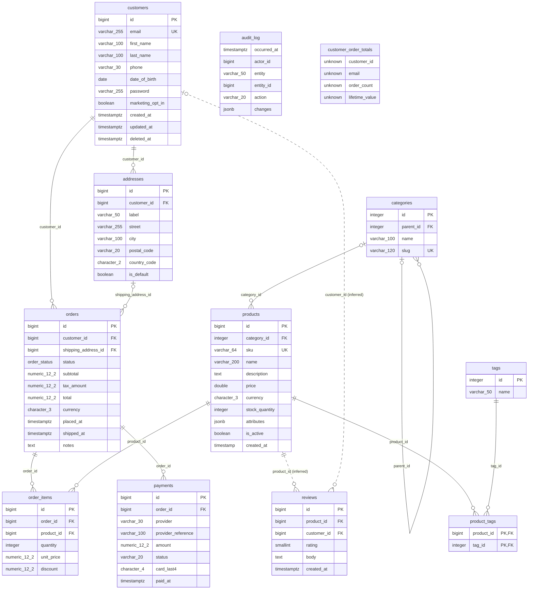

# Schema guide: E-commerce sample (PostgreSQL)

> Generated by [Any Schema](https://github.com/adityakilari/any-schema) v1.0.0 on 2026-10-18 from SQL DDL (PostgreSQL). Explanations are inferred from names, types and constraints, so review them before relying on them.

## Overview

This SQL DDL (PostgreSQL) describes 11 tables and 1 view with 79 columns in total. It looks like an e-commerce data model (based on `product`, `order`, `customer` and `review`). The central tables are `customers` (referenced by 3 tables), `products` (referenced by 3 tables) and `orders` (referenced by 2 tables). There are 12 relationships: 10 declared and 2 inferred from column names, including 1 many-to-many via join tables. The review found 3 high, 9 medium and 1 low priority issues, plus 1 suggestion. 9 columns look like personal or sensitive data, 1 of them highly sensitive.

| Tables | Views | Columns | Relationships | Inferred | Findings | Sensitive columns |
|---|---|---|---|---|---|---|
| 11 | 1 | 79 | 12 | 2 | 14 | 9 |

## Diagram



## Tables

| Table | Role | Purpose |
|---|---|---|
| [customers](#customers) | Core entity | Stores customers: one row per customer, identified by `id`. |
| [addresses](#addresses) | Entity | Stores addresses: one row per address, identified by `id`. |
| [categories](#categories) | Entity | Stores categories: one row per category, identified by `id`. |
| [products](#products) | Core entity | Stores products: one row per product, identified by `id`. |
| [orders](#orders) | Transaction | Records orders: each row is one order, identified by `id`. |
| [order_items](#order_items) | Line items | The individual lines of an order: one row per order item. |
| [payments](#payments) | Transaction | Records payments: each row is one payment, identified by `id`. |
| [reviews](#reviews) | Entity | Stores reviews: one row per review, identified by `id`. |
| [product_tags](#product_tags) | Join table | Connects `products` and `tags` in a many-to-many relationship: each row pairs one product with one tag, so a product can have many tags and the other way round. |
| [tags](#tags) | Lookup | Reference list of tags: a small, mostly static set of values that other tables point to instead of repeating the text. |
| [audit_log](#audit_log) | Log / history | History table: each row records something that happened. |
| [customer_order_totals](#customer_order_totals) | View | A saved query that reads from `customers` and `orders`. |

### customers

**Core entity** · schema `public`

Stores customers: one row per customer, identified by `id`. Referenced by 3 tables: `addresses`, `orders` and `reviews`.

> People who have created an account in the web shop.

| Column | Type | Null | Keys | Description |
|---|---|---|---|---|
| `id` | bigint | no | PK, Auto | Primary key: uniquely identifies each customer. Generated automatically by the database. |
| `email` | character varying(255) | no | UK, PII | Email address of the customer; unique, so it can be used to sign in or look the customer up. Required. Unique: no two customers can share the same value. |
| `first_name` | character varying(100) | yes | PII | First (given) name. |
| `last_name` | character varying(100) | yes | PII | Last (family) name. |
| `phone` | character varying(30) | yes | PII | Phone number. |
| `date_of_birth` | date | yes | PII | Date of birth. |
| `password` | character varying(255) | yes | PII | Password field. Make sure only a strong hash (bcrypt, scrypt, argon2) is stored here, never the plain password. |
| `marketing_opt_in` | boolean | no |  | Consent flag: whether the customer agreed to marketing. Required. Defaults to `false`. _Source comment: Consent to receive marketing email (GDPR)._ |
| `created_at` | timestamp with time zone | no |  | When the customer was created. Required. Defaults to the current date/time. |
| `updated_at` | timestamp with time zone | no |  | When the customer was last changed. Required. Defaults to the current date/time. |
| `deleted_at` | timestamp with time zone | yes | Soft delete | Soft-delete marker: when set, the customer counts as deleted but the row is kept. |

### addresses

**Entity** · schema `public`

Stores addresses: one row per address, identified by `id`. Each address belongs to a customer. Referenced by `orders`.

| Column | Type | Null | Keys | Description |
|---|---|---|---|---|
| `id` | bigint | no | PK | Primary key: uniquely identifies each address. |
| `customer_id` | bigint | no | FK | Foreign key → `customers.id`. Links each address to the customer it belongs to; one customer can have many addresses. Deleting the customer also deletes its addresses. Required: every address must have a customer. |
| `label` | character varying(50) | yes |  | Name of the address, as shown to people. |
| `street` | character varying(255) | no | PII | Street address. Required. |
| `city` | character varying(100) | no |  | City. Required. |
| `postal_code` | character varying(20) | yes | PII | Postal / ZIP code. |
| `country_code` | character(2) | no |  | Two-letter country code (ISO 3166, for example US or DE). Required. |
| `is_default` | boolean | no |  | Yes/no flag: whether the address is default. Required. Defaults to `false`. |

### categories

**Entity** · schema `public`

Stores categories: one row per category, identified by `id`. Categories can point to other categories (via `parent_id`), forming a hierarchy. Referenced by `products`.

| Column | Type | Null | Keys | Description |
|---|---|---|---|---|
| `id` | integer | no | PK | Primary key: uniquely identifies each category. |
| `parent_id` | integer | yes | FK | Foreign key → `categories.id`. Points to another category in the same table, which builds a hierarchy (for example parent and child categories). Empty for top-level categories. |
| `name` | character varying(100) | no |  | Name of the category, as shown to people. Required. |
| `slug` | character varying(120) | no | UK | URL-friendly identifier for the category, usually derived from its name. Required. Unique: no two categories can share the same value. |

### products

**Core entity** · schema `public`

Stores products: one row per product, identified by `id`. It can optionally be linked to a category. Referenced by 3 tables: `order_items`, `product_tags` and `reviews`.

| Column | Type | Null | Keys | Description |
|---|---|---|---|---|
| `id` | bigint | no | PK, Auto | Primary key: uniquely identifies each product. Generated automatically by the database. |
| `category_id` | integer | yes | FK | Foreign key → `categories.id`. Links each product to the category it belongs to; one category can have many products. If the category is deleted, this is cleared. Optional: a product can exist without a category. |
| `sku` | character varying(64) | no | UK | Stock-keeping unit: the code that identifies a sellable product variant. Required. Unique: no two products can share the same value. |
| `name` | character varying(200) | no |  | Name of the product, as shown to people. Required. |
| `description` | text | yes |  | Free-text description or notes for the product. |
| `price` | double precision | no | Money | Monetary amount: price of the product. Stored as floating point, which can introduce rounding errors in money calculations. Required. _Source comment: Unit price in the product currency._ |
| `currency` | character(3) | no |  | Three-letter currency code (ISO 4217, for example USD or EUR) used for the amounts on this product. Required. Defaults to `'USD'`. |
| `stock_quantity` | integer | no |  | Stock quantity: a count of units. Required. Defaults to `0`. |
| `attributes` | jsonb | yes |  | Flexible attributes stored as JSON; its keys can vary from row to row. |
| `is_active` | boolean | no |  | Yes/no flag: whether the product is active. Required. Defaults to `true`. |
| `created_at` | timestamp without time zone | no |  | When the product was created. Required. Defaults to the current date/time. |

### orders

**Transaction** · schema `public`

Records orders: each row is one order, identified by `id`. Each order belongs to a customer. It can optionally be linked to an address. Referenced by 2 tables: `order_items` and `payments`.

> A checkout by a customer. Totals are snapshotted at purchase time.

| Column | Type | Null | Keys | Description |
|---|---|---|---|---|
| `id` | bigint | no | PK, Auto | Primary key: uniquely identifies each order. Generated automatically by the database. |
| `customer_id` | bigint | no | FK, Indexed | Foreign key → `customers.id`. Links each order to the customer it belongs to; one customer can have many orders. Required: every order must have a customer. |
| `shipping_address_id` | bigint | yes | FK | Foreign key → `addresses.id`. Links each order to its shipping address (an address record). Optional: an order can exist without an address. |
| `status` | public.order_status | no |  | Current status of the order. One of: `pending`, `paid`, `shipped`, `delivered`, `cancelled`, `refunded`. Required. Defaults to `'pending'`. |
| `subtotal` | numeric(12,2) | no | Money | Monetary amount: subtotal of the order. Stored as an exact decimal, which is right for money. Required. |
| `tax_amount` | numeric(12,2) | no | Money | Monetary amount: tax amount of the order. Stored as an exact decimal, which is right for money. Required. Defaults to `0`. |
| `total` | numeric(12,2) | no | Money | Monetary amount: total of the order. Stored as an exact decimal, which is right for money. Required. |
| `currency` | character(3) | no |  | Three-letter currency code (ISO 4217, for example USD or EUR) used for the amounts on this order. Required. Defaults to `'USD'`. |
| `placed_at` | timestamp with time zone | no |  | When the order was placed. Required. Defaults to the current date/time. |
| `shipped_at` | timestamp with time zone | yes |  | When the order was shipped. |
| `notes` | text | yes |  | Free-text description or notes for the order. |

### order_items

**Line items** · schema `public`

The individual lines of an order: one row per order item. Each order item belongs to an order and a product.

| Column | Type | Null | Keys | Description |
|---|---|---|---|---|
| `id` | bigint | no | PK, Auto | Primary key: uniquely identifies each order item. Generated automatically by the database. |
| `order_id` | bigint | no | FK, Indexed | Foreign key → `orders.id`. Links each order item to the order it belongs to; one order can have many order items. Deleting the order also deletes its order items. Required: every order item must have an order. |
| `product_id` | bigint | no | FK | Foreign key → `products.id`. Links each order item to the product it belongs to; one product can have many order items. A product cannot be deleted while order items still point to it. Required: every order item must have a product. |
| `quantity` | integer | no |  | How many units this order item covers. Required. |
| `unit_price` | numeric(12,2) | no | Money | Monetary amount: unit price of the order item. Stored as an exact decimal, which is right for money. Required. |
| `discount` | numeric(12,2) | no | Money | Monetary amount: discount of the order item. Stored as an exact decimal, which is right for money. Required. Defaults to `0`. |

### payments

**Transaction** · schema `public`

Records payments: each row is one payment, identified by `id`. Each payment belongs to an order.

| Column | Type | Null | Keys | Description |
|---|---|---|---|---|
| `id` | bigint | no | PK | Primary key: uniquely identifies each payment. |
| `order_id` | bigint | no | FK | Foreign key → `orders.id`. Links each payment to the order it belongs to; one order can have many payments. Required: every payment must have an order. |
| `provider` | character varying(30) | no |  | Text (up to 30 characters): the payment's provider. Required. |
| `provider_reference` | character varying(100) | yes |  | Text (up to 100 characters): the payment's provider reference. |
| `amount` | numeric(12,2) | no | Money | Monetary amount: amount of the payment. Stored as an exact decimal, which is right for money. Required. |
| `status` | character varying(20) | no |  | Current status of the payment. Stored as free text; listing the allowed values (an enum or check constraint) would prevent typos. Required. |
| `card_last4` | character(4) | yes |  | Last four digits of the payment card: enough to show the customer which card was used, without storing the full number. |
| `paid_at` | timestamp with time zone | yes |  | When the payment was paid. |

### reviews

**Entity** · schema `public`

Stores reviews: one row per review, identified by `id`. Each review belongs to a product. It can optionally be linked to a customer.

| Column | Type | Null | Keys | Description |
|---|---|---|---|---|
| `id` | bigint | no | PK | Primary key: uniquely identifies each review. |
| `product_id` | bigint | no | FK? | Probably references `products.id`. Links each review to the product it belongs to; one product can have many reviews. Inferred from the column name: no foreign-key constraint is declared. Required: every review must have a product. |
| `customer_id` | bigint | yes | FK? | Probably references `customers.id`. Links each review to the customer it belongs to; one customer can have many reviews. Inferred from the column name: no foreign-key constraint is declared. Optional: a review can exist without a customer. |
| `rating` | smallint | no |  | Rating given to the review. Required. |
| `body` | text | yes |  | Free-text content for the review. |
| `created_at` | timestamp with time zone | no |  | When the review was created. Required. Defaults to the current date/time. |

### product_tags

**Join table** · schema `public`

Connects `products` and `tags` in a many-to-many relationship: each row pairs one product with one tag, so a product can have many tags and the other way round.

| Column | Type | Null | Keys | Description |
|---|---|---|---|---|
| `product_id` | bigint | no | PK, FK | Part of the composite primary key (`product_id` + `tag_id`): together these columns identify each product tag uniquely. Deleting the product also deletes its product tags. |
| `tag_id` | integer | no | PK, FK | Part of the composite primary key (`product_id` + `tag_id`): together these columns identify each product tag uniquely. Deleting the tag also deletes its product tags. |

### tags

**Lookup** · schema `public`

Reference list of tags: a small, mostly static set of values that other tables point to instead of repeating the text. Referenced by `product_tags`.

| Column | Type | Null | Keys | Description |
|---|---|---|---|---|
| `id` | integer | no | PK | Primary key: uniquely identifies each tag. |
| `name` | character varying(50) | no |  | Name of the tag, as shown to people. Required. |

### audit_log

**Log / history** · schema `public`

History table: each row records something that happened. Rows are usually only ever added, not changed.

| Column | Type | Null | Keys | Description |
|---|---|---|---|---|
| `occurred_at` | timestamp with time zone | no |  | When it occurred. Required. Defaults to the current date/time. |
| `actor_id` | bigint | yes |  | Whole number: the audit log's actor id. |
| `entity` | character varying(50) | no | Indexed | Text (up to 50 characters): the audit log's entity. Required. |
| `entity_id` | bigint | no |  | Whole number: the audit log's entity id. Required. |
| `action` | character varying(20) | no |  | Text (up to 20 characters): the audit log's action. Required. |
| `changes` | jsonb | yes |  | Flexible changes stored as JSON; its keys can vary from row to row. |

### customer_order_totals

**View** · schema `public`

A saved query that reads from `customers` and `orders`. It stores no data of its own.

| Column | Type | Null | Keys | Description |
|---|---|---|---|---|
| `customer_id` | unknown | yes |  | Value: the customer order total's customer id. |
| `email` | unknown | yes | PII | Email address. |
| `order_count` | unknown | yes |  | Number of orders for this customer order total (often a cached counter). |
| `lifetime_value` | unknown | yes |  | Value: the customer order total's lifetime value. |

## Relationships

| From | To | Type | Source |
|---|---|---|---|
| `addresses.customer_id` | `customers.id` | many-to-one | declared |
| `categories.parent_id` | `categories.id` | many-to-one | declared |
| `products.category_id` | `categories.id` | many-to-one | declared |
| `orders.customer_id` | `customers.id` | many-to-one | declared |
| `orders.shipping_address_id` | `addresses.id` | many-to-one | declared |
| `order_items.order_id` | `orders.id` | many-to-one | declared |
| `order_items.product_id` | `products.id` | many-to-one | declared |
| `payments.order_id` | `orders.id` | many-to-one | declared |
| `product_tags.product_id` | `products.id` | many-to-one | declared |
| `product_tags.tag_id` | `tags.id` | many-to-one | declared |
| `reviews.product_id` | `products.id` | many-to-one | inferred (high) |
| `reviews.customer_id` | `customers.id` | many-to-one | inferred (high) |
| `products` | `tags` | many-to-many via `product_tags` | join table |

## Findings

- **HIGH** · customers.password may hold plain-text passwords  
  The name does not say it is a hash. Store only a slow, salted hash (bcrypt, scrypt or argon2) and consider renaming the column to password_hash so its contents are clear.
- **HIGH** · products.price stores money as floating point  
  double precision cannot represent values like 0.10 exactly, so totals drift by fractions of a cent. Use an exact type.

  ```sql
  ALTER TABLE public.products ALTER COLUMN price TYPE DECIMAL(12,2);
  ```
- **HIGH** · audit_log has no primary key  
  Without a primary key, rows can be duplicated, updates and deletes are ambiguous, and many tools (ORMs, replication, CDC) will not work properly.

  ```sql
  ALTER TABLE public.audit_log ADD PRIMARY KEY (<column>);
  ```
- **MEDIUM** · Foreign key addresses.customer_id has no index  
  Joins from customers to addresses, and deletes on customers, will scan the whole addresses table. PostgreSQL does not index foreign keys automatically.

  ```sql
  CREATE INDEX idx_addresses_customer_id ON public.addresses (customer_id);
  ```
- **MEDIUM** · Foreign key categories.parent_id has no index  
  Joins from categories to categories, and deletes on categories, will scan the whole categories table. PostgreSQL does not index foreign keys automatically.

  ```sql
  CREATE INDEX idx_categories_parent_id ON public.categories (parent_id);
  ```
- **MEDIUM** · Foreign key products.category_id has no index  
  Joins from categories to products, and deletes on categories, will scan the whole products table. PostgreSQL does not index foreign keys automatically.

  ```sql
  CREATE INDEX idx_products_category_id ON public.products (category_id);
  ```
- **MEDIUM** · Foreign key orders.shipping_address_id has no index  
  Joins from addresses to orders, and deletes on addresses, will scan the whole orders table. PostgreSQL does not index foreign keys automatically.

  ```sql
  CREATE INDEX idx_orders_shipping_address_id ON public.orders (shipping_address_id);
  ```
- **MEDIUM** · Foreign key order_items.product_id has no index  
  Joins from products to order_items, and deletes on products, will scan the whole order_items table. PostgreSQL does not index foreign keys automatically.

  ```sql
  CREATE INDEX idx_order_items_product_id ON public.order_items (product_id);
  ```
- **MEDIUM** · Foreign key payments.order_id has no index  
  Joins from orders to payments, and deletes on orders, will scan the whole payments table. PostgreSQL does not index foreign keys automatically.

  ```sql
  CREATE INDEX idx_payments_order_id ON public.payments (order_id);
  ```
- **MEDIUM** · Foreign key product_tags.tag_id has no index  
  Joins from tags to product_tags, and deletes on tags, will scan the whole product_tags table. PostgreSQL does not index foreign keys automatically.

  ```sql
  CREATE INDEX idx_product_tags_tag_id ON public.product_tags (tag_id);
  ```
- **MEDIUM** · reviews.product_id looks like a foreign key but has no constraint  
  Nothing stops it from pointing at a product that does not exist. Add a constraint after checking for orphan rows.

  ```sql
  ALTER TABLE public.reviews ADD CONSTRAINT fk_reviews_product_id FOREIGN KEY (product_id) REFERENCES public.products (id);
  ```
- **MEDIUM** · reviews.customer_id looks like a foreign key but has no constraint  
  Nothing stops it from pointing at a customer that does not exist. Add a constraint after checking for orphan rows.

  ```sql
  ALTER TABLE public.reviews ADD CONSTRAINT fk_reviews_customer_id FOREIGN KEY (customer_id) REFERENCES public.customers (id);
  ```
- **LOW** · 1 timestamp column does not store a time zone  
  `products.created_at` is `timestamp without time zone`. Values are ambiguous once servers or users span time zones; `timestamptz` stores an absolute instant.

  ```sql
  ALTER TABLE public.products ALTER COLUMN created_at TYPE timestamptz;
  ```
- **INFO** · payments.status accepts any text  
  Status-like columns usually have a fixed set of values. A CHECK constraint, enum or lookup table prevents typos such as "Shipped" vs "shipped".

  ```sql
  ALTER TABLE public.payments ADD CONSTRAINT payments_status_check CHECK (status IN ('<value1>', '<value2>'));
  ```

## Personal and sensitive data

Columns that look like personal data based on their names. Check them against your data-protection obligations (masking in non-production, access control, retention).

| Table | Column | Category | Sensitivity |
|---|---|---|---|
| customers | `email` | Contact | medium |
| customers | `first_name` | Person name | medium |
| customers | `last_name` | Person name | medium |
| customers | `phone` | Contact | medium |
| customers | `date_of_birth` | Date of birth | medium |
| customers | `password` | Credential | high |
| addresses | `street` | Address | medium |
| addresses | `postal_code` | Address | medium |
| customer_order_totals | `email` | Contact | medium |

## Enumerations

| Name | Values |
|---|---|
| `order_status` | `pending`, `paid`, `shipped`, `delivered`, `cancelled`, `refunded` |
