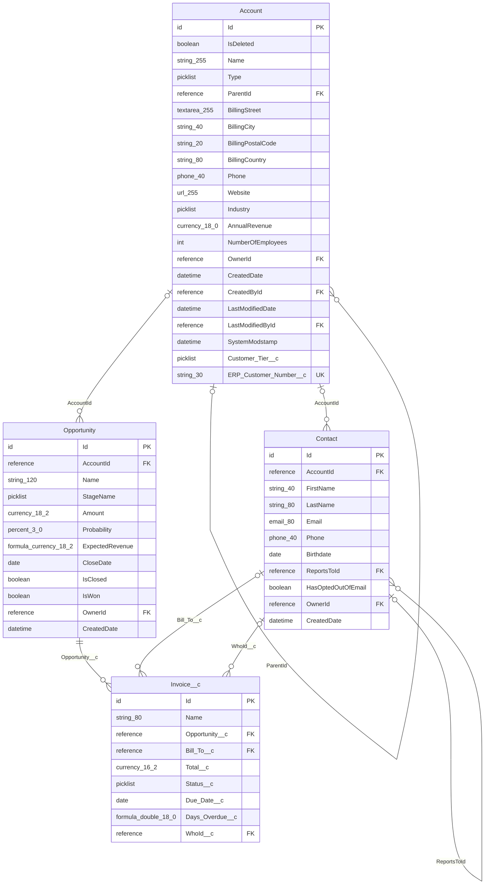

# Schema guide: Salesforce sample

> Generated by [Any Schema](https://github.com/adityakilari/any-schema) v1.0.0 on 2026-10-18 from Salesforce describe. Explanations are inferred from names, types and constraints, so review them before relying on them.

## Overview

This Salesforce describe describes 4 objects with 54 fields in total. It looks like a CRM data model (based on `account`, `contact` and `opportunity`). The central object is `Account` (referenced by 2 objects). There are 7 relationships: 7 declared. 6 references point to objects that are not in this file. The review found no issues. 8 fields look like personal or sensitive data.

| Objects | Views | Fields | Relationships | Inferred | Findings | Sensitive fields |
|---|---|---|---|---|---|---|
| 4 | 0 | 54 | 7 | 0 | 0 | 8 |

## Diagram

## Objects

| Object | Role | Purpose |
|---|---|---|
| [Account](#account) | Core entity | Stores accounts: one row per account, identified by `Id`. |
| [Contact](#contact) | Core entity | Stores contacts: one row per contact, identified by `Id`. |
| [Opportunity](#opportunity) | Transaction | Records opportunities: each row is one opportunity, identified by `Id`. |
| [Invoice__c](#invoice__c) | Transaction | Records invoices: each row is one invoice, identified by `Id`. |

### Account

**Core entity**

Stores accounts: one row per account, identified by `Id`. Each account is owned by a user. Accounts can point to other accounts (via `ParentId`), forming a hierarchy. Referenced by 2 objects: `Contact` and `Opportunity`.

| Field | Type | Null | Keys | Description |
|---|---|---|---|---|
| `Id` | id | no | PK | Salesforce record Id: the 18-character id that uniquely identifies each account. |
| `IsDeleted` | boolean | no | Soft delete | Soft-delete flag: true means the account counts as deleted, but the row is kept. Required. |
| `Name` | string(255) | no | Indexed | Name of the account, as shown to people. Required. |
| `Type` | picklist | yes |  | Classifies the account by type. One of: `Prospect`, `Customer - Direct`, `Customer - Channel`, `Partner`, `Other`. |
| `ParentId` | reference | yes | FK | Foreign key → `Account.Id`. Points to another account in the same table, which builds a hierarchy (for example parent and child accounts). Empty for top-level accounts. |
| `BillingStreet` | textarea(255) | yes | PII | Street address (billing). |
| `BillingCity` | string(40) | yes |  | Text (up to 40 characters): the account's billing city. |
| `BillingPostalCode` | string(20) | yes | PII | Postal / ZIP code. |
| `BillingCountry` | string(80) | yes |  | Text (up to 80 characters): the account's billing country. |
| `Phone` | phone(40) | yes | PII | Phone number. |
| `Website` | url(255) | yes |  | Web address (URL). |
| `Industry` | picklist | yes | Enum | One of a fixed set of values: the account's industry. Allowed values: `Banking`, `Education`, `Healthcare`, `Manufacturing`, `Retail`, `Technology`. |
| `AnnualRevenue` | currency(18,0) | yes | Money | Monetary amount: annual revenue of the account. Stored as an exact decimal, which is right for money. |
| `NumberOfEmployees` | int | yes |  | Number of employees for this account. |
| `OwnerId` | reference | no | FK | Foreign key → `User.Id`. The user who owns this account. Required: every account must have a user. |
| `CreatedDate` | datetime | no |  | When the account was created. Required. |
| `CreatedById` | reference | no | FK | Foreign key → `User.Id`. The user who created this account. |
| `LastModifiedDate` | datetime | no |  | When the account was last changed. Required. |
| `LastModifiedById` | reference | no | FK | Foreign key → `User.Id`. The user who last changed this account. |
| `SystemModstamp` | datetime | no |  | System timestamp: updated whenever the record changes, including changes made by automation. Required. |
| `Customer_Tier__c` | picklist | yes |  | Classifies the account by customer tier. One of: `Bronze`, `Silver`, `Gold`. _Source comment: Service tier that drives SLA response times._ |
| `ERP_Customer_Number__c` | string(30) | yes | UK, External ID | Erp customer number (optional). Unique: no two accounts can share the same value. External ID: used to match records from other systems during upserts. |

### Contact

**Core entity**

Stores contacts: one row per contact, identified by `Id`. Each contact is owned by a user. It can optionally be linked to an account. Contacts can point to other contacts (via `ReportsToId`), forming a hierarchy. Referenced by `Invoice__c`.

| Field | Type | Null | Keys | Description |
|---|---|---|---|---|
| `Id` | id | no | PK | Salesforce record Id: the 18-character id that uniquely identifies each contact. |
| `AccountId` | reference | yes | FK | Foreign key → `Account.Id`. Links each contact to the account it belongs to; one account can have many contacts. Optional: a contact can exist without an account. |
| `FirstName` | string(40) | yes | PII | First (given) name. |
| `LastName` | string(80) | no | PII | Last (family) name. Required. |
| `Email` | email(80) | yes | PII | Email address. |
| `Phone` | phone(40) | yes | PII | Phone number. |
| `Birthdate` | date | yes | PII | Date of birth. |
| `ReportsToId` | reference | yes | FK | Foreign key → `Contact.Id`. Points to the contact this contact reports to, which builds a reporting hierarchy. Empty for top-level contacts. |
| `HasOptedOutOfEmail` | boolean | no |  | Yes/no flag: whether the contact has opted out of email. Required. Defaults to `false`. |
| `OwnerId` | reference | no | FK | Foreign key → `User.Id`. The user who owns this contact. Required: every contact must have a user. |
| `CreatedDate` | datetime | no |  | When the contact was created. Required. |

### Opportunity

**Transaction**

Records opportunities: each row is one opportunity, identified by `Id`. Each opportunity is owned by a user. It can optionally be linked to an account. Referenced by `Invoice__c`.

| Field | Type | Null | Keys | Description |
|---|---|---|---|---|
| `Id` | id | no | PK | Salesforce record Id: the 18-character id that uniquely identifies each opportunity. |
| `AccountId` | reference | yes | FK | Foreign key → `Account.Id`. Links each opportunity to the account it belongs to; one account can have many opportunities. Optional: an opportunity can exist without an account. |
| `Name` | string(120) | no |  | Name of the opportunity, as shown to people. Required. |
| `StageName` | picklist | no |  | Current stage of the opportunity. One of: `Prospecting`, `Qualification`, `Proposal/Price Quote`, `Negotiation/Review`, `Closed Won`, `Closed Lost`. Required. |
| `Amount` | currency(18,2) | yes | Money | Monetary amount: amount of the opportunity. Stored as an exact decimal, which is right for money. |
| `Probability` | percent(3,0) | yes |  | Probability (%). |
| `ExpectedRevenue` | formula currency(18,2) | yes | Money, Formula | Monetary amount: expected revenue of the opportunity. Stored as an exact decimal, which is right for money. Formula field: calculated by Salesforce, read-only. |
| `CloseDate` | date | no |  | Close date of the opportunity. Required. |
| `IsClosed` | boolean | no |  | Yes/no flag: whether the opportunity is closed. Required. |
| `IsWon` | boolean | no |  | Yes/no flag: whether the opportunity is won. Required. |
| `OwnerId` | reference | no | FK | Foreign key → `User.Id`. The user who owns this opportunity. Required: every opportunity must have a user. |
| `CreatedDate` | datetime | no |  | When the opportunity was created. Required. |

### Invoice__c

**Transaction** · label "Invoice"

Records invoices: each row is one invoice, identified by `Id`. Each invoice belongs to an opportunity. It can optionally be linked to a contact and a lead.

> Custom object (Invoices).

| Field | Type | Null | Keys | Description |
|---|---|---|---|---|
| `Id` | id | no | PK | Salesforce record Id: the 18-character id that uniquely identifies each invoice. |
| `Name` | string(80) | yes | Auto | Name of the invoice, as shown to people. Auto-generated number. |
| `Opportunity__c` | reference | no | FK | Foreign key → `Opportunity.Id`. Links each invoice to the opportunity it belongs to; one opportunity can have many invoices. Master-detail: the opportunity owns this record, and deleting it deletes this invoice too. Required: every invoice must have an opportunity. |
| `Bill_To__c` | reference | yes | FK | Foreign key → `Contact.Id`. Links each invoice to its bill to (a contact record). Optional: an invoice can exist without a contact. |
| `Total__c` | currency(16,2) | yes | Money | Monetary amount: total of the invoice. Stored as an exact decimal, which is right for money. |
| `Status__c` | picklist | yes |  | Current status of the invoice. One of: `Draft`, `Sent`, `Paid`, `Void`. Defaults to `Draft`. |
| `Due_Date__c` | date | yes |  | Due date of the invoice. |
| `Days_Overdue__c` | formula double(18,0) | yes | Formula | Exact decimal number: the invoice's days overdue. Formula field: calculated by Salesforce, read-only. |
| `WhoId__c` | reference | yes | FK | Foreign key → `Contact.Id`. Polymorphic reference: points to `Contact` and `Lead`. |

## Relationships

| From | To | Type | Source |
|---|---|---|---|
| `Account.ParentId` | `Account.Id` | many-to-one | declared |
| `Account.OwnerId` | `User.Id` (not in file) | many-to-one | declared |
| `Contact.AccountId` | `Account.Id` | many-to-one | declared |
| `Contact.ReportsToId` | `Contact.Id` | many-to-one | declared |
| `Contact.OwnerId` | `User.Id` (not in file) | many-to-one | declared |
| `Opportunity.AccountId` | `Account.Id` | many-to-one | declared |
| `Opportunity.OwnerId` | `User.Id` (not in file) | many-to-one | declared |
| `Invoice__c.Opportunity__c` | `Opportunity.Id` | many-to-one (master-detail) | declared |
| `Invoice__c.Bill_To__c` | `Contact.Id` | many-to-one | declared |
| `Invoice__c.WhoId__c` | `Contact.Id` | many-to-one (polymorphic) | declared |
| `Invoice__c.WhoId__c` | `Lead.Id` (not in file) | many-to-one (polymorphic) | declared |

## Findings

No issues found.

## Personal and sensitive data

Fields that look like personal data based on their names. Check them against your data-protection obligations (masking in non-production, access control, retention).

| Object | Field | Category | Sensitivity |
|---|---|---|---|
| Account | `BillingStreet` | Address | medium |
| Account | `BillingPostalCode` | Address | medium |
| Account | `Phone` | Contact | medium |
| Contact | `FirstName` | Person name | medium |
| Contact | `LastName` | Person name | medium |
| Contact | `Email` | Contact | medium |
| Contact | `Phone` | Contact | medium |
| Contact | `Birthdate` | Date of birth | medium |
